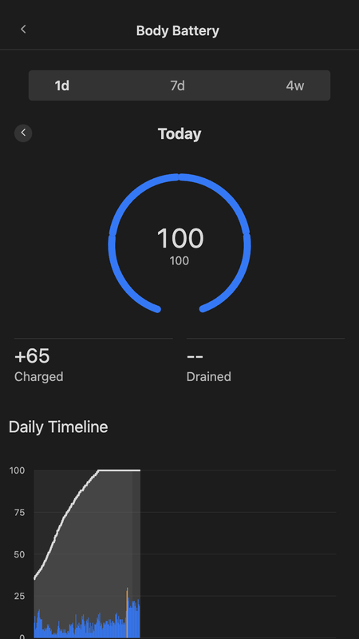
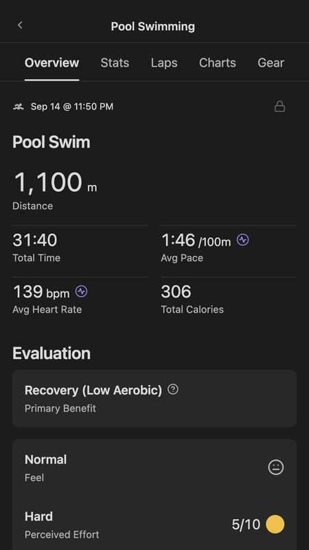
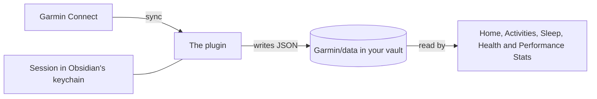

# Garmin Connect for Obsidian

**Garmin Connect, rebuilt inside Obsidian.** 
Sync your Garmin health and activity data into your vault, and browse it on pages that mirror the
phone app, on desktop and mobile.

[Install](docs/INSTALLATION.md) · [Guide](docs/GUIDE.md) · [FAQ](docs/FAQ.md) · [Troubleshooting](docs/troubleshooting.md) · [Contributing](docs/CONTRIBUTING.md)

  

> [!IMPORTANT]
> **Beta, and unofficial.** The plugin has met one Garmin account in depth, and yours will differ.
> It is not affiliated with or endorsed by Garmin.

## Features

- **Home:** Garmin's three presets, In Focus and At a Glance, built to match the phone number for
  number.
- **Activities:**
  - a page per sport, with totals and personal records;
  - All Activities, with Garmin's search, filters and sort.
- **A page for every activity:** a run's or a ride's map, stats, laps and charts, a pool swim's
  intervals and lengths, and every other sport.
- **Steps, Floors and Intensity Minutes,** and **Sleep** with the Sleep Coach.
- **Health Stats:** Health Status, Heart Rate, Stress, Body Battery, Respiration, Pulse Ox and its
  acclimation, Weight, Blood Pressure, Fitness Age and Health Snapshot.
- **Performance Stats:**
  - Training Status, Training Readiness, HRV Status, VO₂ Max and Race Predictor;
  - Endurance Score, Hill Score, Running Tolerance, FTP and Running Lactate Threshold;
  - Running Economy, Training Effect, Cycling Power Curve, Critical Swim Speed and HRV Stress;
  - Load and Heat Acclimation.
- **Your data stays yours:** plain JSON files in one folder of your vault. It writes no notes.
- **Private by design:** the password is never stored, the session stays in Obsidian's keychain,
  and there is no telemetry.
- **Gentle with Garmin:** paced requests and an hourly budget, and it backs off when Garmin asks.

## How it works

The plugin signs in to Garmin Connect, syncs your data into plain JSON files in your vault, and draws
Garmin's pages from those files. So the pages open offline, on every device your vault syncs to.

## Install

The plugin is in beta and installs with [BRAT](https://github.com/TfTHacker/obsidian42-brat). It
needs Obsidian 1.11.4 or later.

1. Install **BRAT** from Obsidian's community plugins.
2. In BRAT, choose **Add a beta plugin** and enter `tareqayz/Obsidian-Garmin-Connect`.
3. Enable **Garmin Connect** in **Settings → Community plugins**.

To install by hand or from source, see [Installation](docs/INSTALLATION.md).

## Get started

Enabling the plugin opens a setup over Home:
1. **Sign in** to your Garmin account. Multi-factor authentication is asked for in the same dialog.
2. **Scan:** a few requests find where your Garmin history starts.
3. **Choose** how much history to keep. Each choice shows its size and how long it takes.
4. **Start:** the history downloads in the background, under an hourly request limit, and carries on
   after a restart.

Then sync with Home's ↻ button, **Sync recent days**, or **Sync on startup**. The
[Guide](docs/GUIDE.md) covers every page and command.

## Storage

Everything is plain JSON in one data folder, `Garmin/data` by default. How much room it takes depends
on how much history you keep:

| Data set | Holds | Size |
| --- | --- | --- |
| **Charts & trends** | every page's 7-day, 4-week and 1-year history, always all of it | under 1 MB a year of history |
| **Day details** | each day's numbers and its timelines | about 44 KB a day, 16 MB a year |
| **Activity details** | an activity's map, charts and laps, every sport; by default only the activities you open | about 150 KB a run, less for most others |

With Obsidian Sync, turn on **Sync all other types** so the JSON reaches your other devices. Every
file and key is in the [Data reference](docs/properties.md).

## Privacy and network use

- **You need a Garmin Connect account.** The plugin signs in the way Garmin's mobile app does. Your
  password is used for the sign-in and never stored, and the session stays on the device, in
  Obsidian's keychain, never in the vault.
- **It talks to Garmin** at `sso.garmin.com`, `diauth.garmin.com` and `connectapi.garmin.com` (or
  their `garmin.cn` counterparts), to sign in and to fetch your data.
- **Activity maps** draw OpenStreetMap's map under an activity's route, from
  `tile.openstreetmap.org`. That server sees which part of the map you open, roughly where the
  activity was, and each request names this plugin. Turn **Map tiles** off in the settings, and the
  route is drawn on its own with no request at all.
- **`tls.peet.ws`** is asked what your connection looks like, but only when you run the network check
  in **Run diagnostics**.
- **There is no telemetry and no analytics.**
- **Outside the vault** it keeps only the session, a few local-storage keys and a cache of map tiles,
  on each device.

What is stored where, and how it is redacted, is in [Security](docs/SECURITY.md).

## Known limitations

- **Language and units:**
  - English only, with times on a 12-hour clock whatever your account says.
  - Imperial units are drawn but unverified; a UK account (`statute_uk`) shows pounds and °F.
  - Weeks follow fixed starts (Monday for steps, Sunday for some performance charts), not your
    account's first day of the week.
- **Activities:** multisport activities get the generic page, without their legs
  ([#23](https://github.com/tareqayz/Obsidian-Garmin-Connect/issues/23)).
- **Untested:** Android, garmin.cn accounts, and multi-factor sign-in against a live challenge.
- **Syncing:**
  - With a scale or a second Garmin device, data a watch uploads days late may need **Sync a date
    range…**.
  - Data refreshes when you sync; there is no background interval.
  - Sign in on one device if you can, usually the computer, and let your other devices show what it
    syncs. Two devices syncing the same files at once is how sync services make conflict copies.

Worth testing

Reports on any of these help the most:
- signing in with multi-factor authentication;
- Android, phones and tablets;
- imperial and UK accounts, and accounts whose week starts on Monday;
- five to ten years of history;
- sports other than running.

## Feedback and support

- **Something broken?** Start with [Troubleshooting](docs/troubleshooting.md).
- **Reporting a bug:** run **Copy debug info** and paste it into the
  [bug report form](https://github.com/tareqayz/Obsidian-Garmin-Connect/issues/new/choose).
  - It needs no password, makes no request, and removes your email, tokens, IP address and Garmin
    names.
  - Don't paste screenshots of maps that show where you live.
- **A security problem:** report it privately through the
  [security advisory form](https://github.com/tareqayz/Obsidian-Garmin-Connect/security/advisories/new).

## Removing the plugin

Uninstalling deletes the plugin's folder and your settings with it. Your synced data stays in the
vault, and the device you uninstall from offers to keep it or move it to the trash. **Settings →
Danger zone → Delete synced data** removes it without uninstalling. See
[Security](docs/SECURITY.md#removing-the-plugin-and-its-data).

## Documentation

| Using the plugin | |
| --- | --- |
| [Installation](docs/INSTALLATION.md) | BRAT, by hand, a second device, from source |
| [Guide](docs/GUIDE.md) | setup, syncing, what to keep, every page and command |
| [Troubleshooting](docs/troubleshooting.md) | problems by symptom, and the diagnostics |
| [FAQ](docs/FAQ.md) | short answers |
| [Settings](docs/settings.md) | every setting and what it does |
| [Data reference](docs/properties.md) | every file and key the sync writes |
| [Security](docs/SECURITY.md) | what is stored, what leaves your device, reporting a vulnerability |

| Working on the plugin | |
| --- | --- |
| [Contributing](docs/CONTRIBUTING.md) | branches, releases, data versions, local development, writing docs |
| [Architecture](docs/architecture.md) | how the system fits together, with diagrams |
| [Building pages](docs/building-pages.md) | how the pages inside Home work, and how to add one |
| [Garmin API](docs/garmin-api.md) | every endpoint called, sign-in, and the request budget |
| [API catalogue](api/README.md) | the full endpoint list, the recorded shapes and the daily check |
| [Changelog](CHANGELOG.md) | what changed in each release |

## Acknowledgements

- [Garmin Health Sync](https://github.com/fcandi/Garmin-Health-Sync): the inspiration for the
  project, and I *believe* the first Garmin–Obsidian plugin. I took a lot of its ideas, like file
  properties on daily notes, but wanted headless sign-in, cross-platform support and data
  visualisation. I started by seeing if headless authentication was possible and kept building from
  there.
- [cyberjunky/python-garminconnect](https://github.com/cyberjunky/python-garminconnect): an actively
  maintained Garmin Connect library that saved a huge amount of reverse-engineering work.
- [Lucide](https://lucide.dev) (ISC): the watch in the logo and the ribbon icon. Everything else uses
  Obsidian's own Lucide icons.
- [Tabler Icons](https://tabler.io/icons) (MIT): the sport figures on the Activities pages.
- [Leaflet](https://leafletjs.com) (BSD-2-Clause): the activity maps, bundled with the plugin.
- [OpenStreetMap](https://www.openstreetmap.org/copyright): the map under a route, © OpenStreetMap
  contributors, available under the Open Database License.

## License

[MIT](LICENSE) © Tareq Alansari.

Not affiliated with or endorsed by Garmin. Garmin, Garmin Connect, Body Battery and the other Garmin
names are trademarks of Garmin Ltd. or its subsidiaries.
