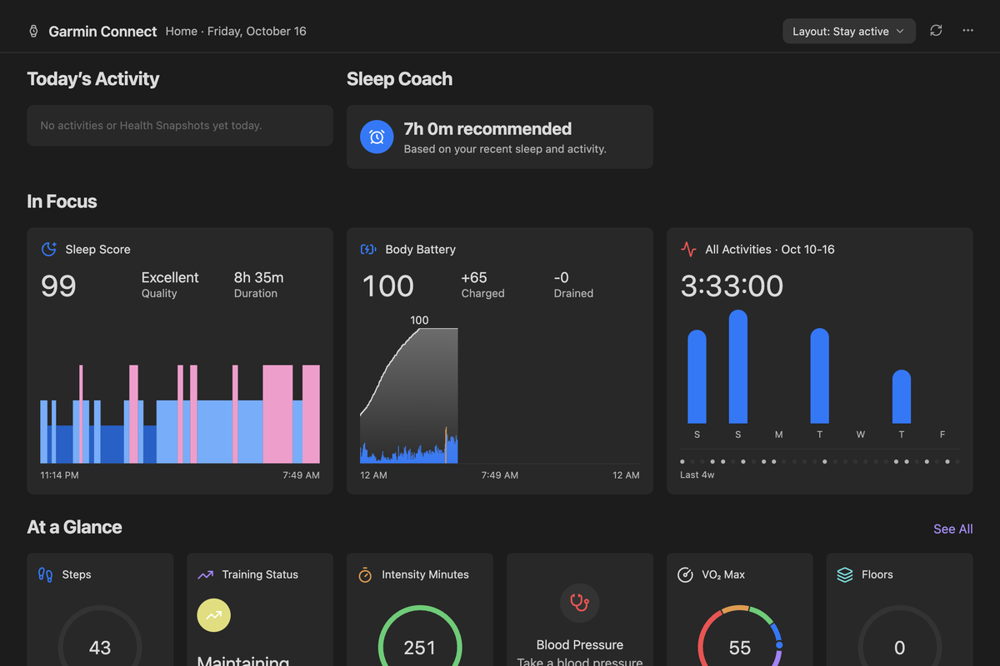
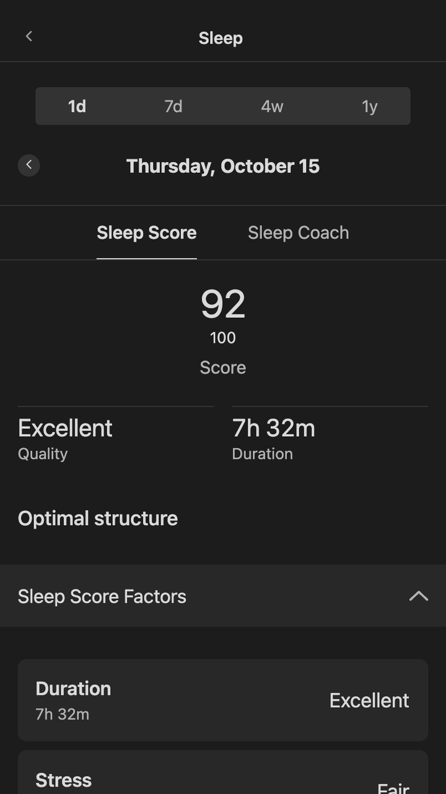
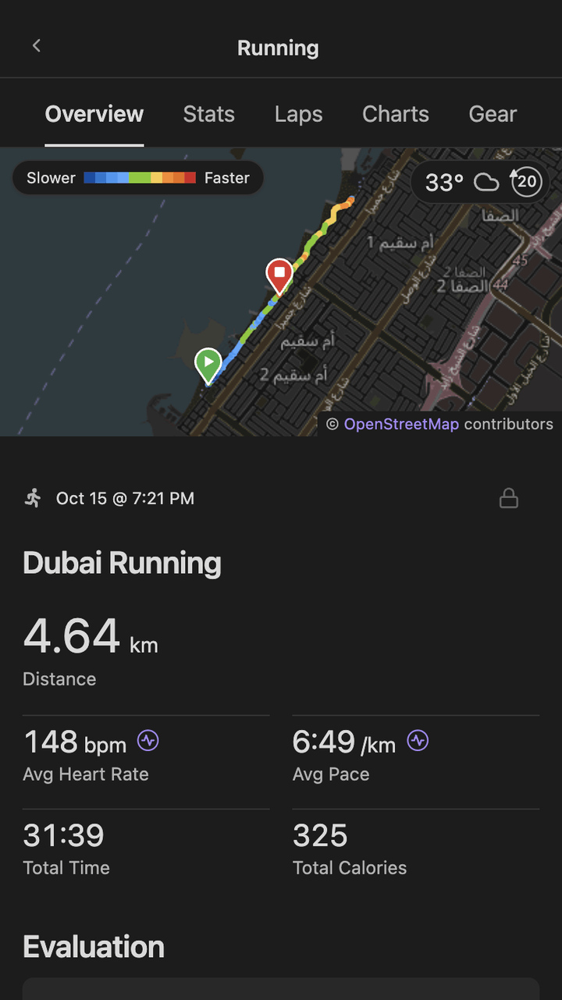
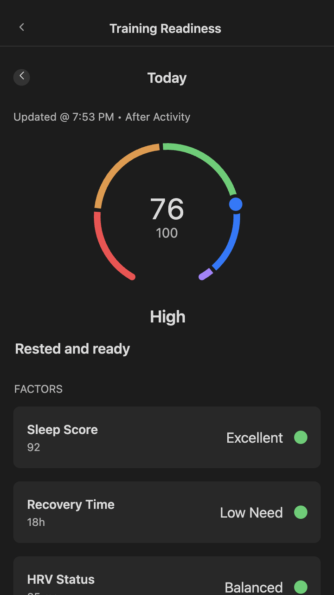
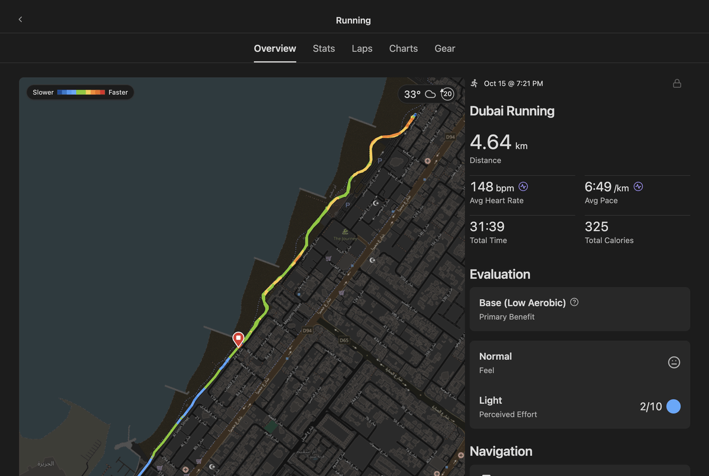
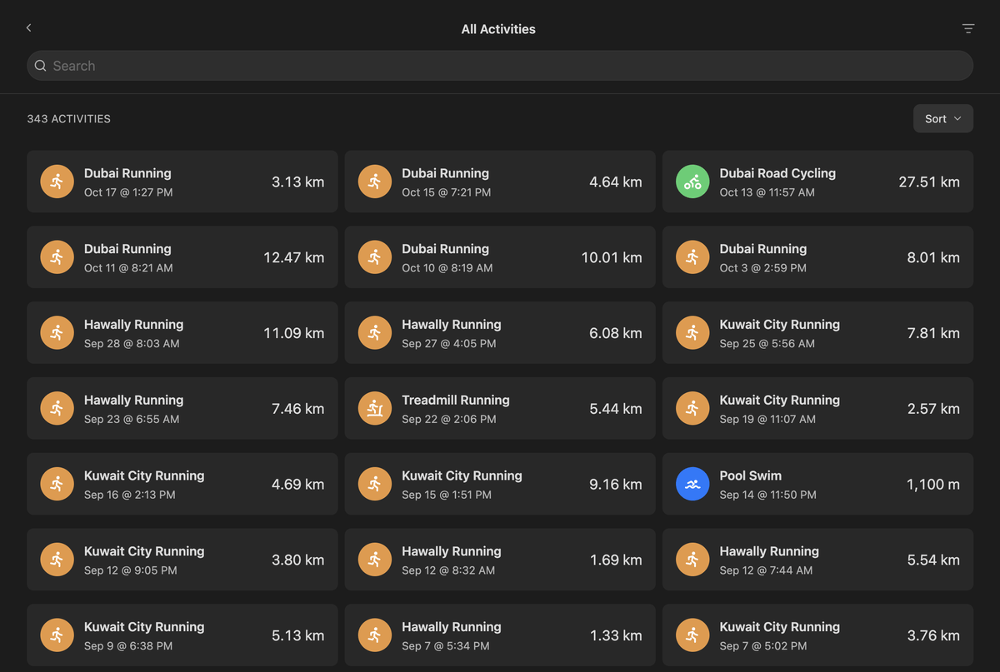
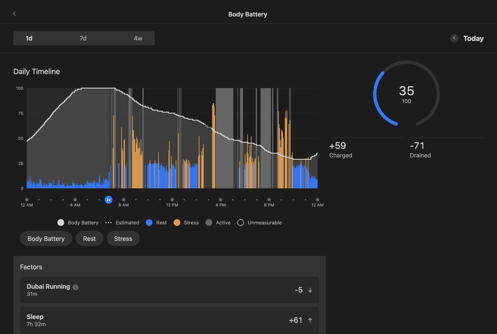
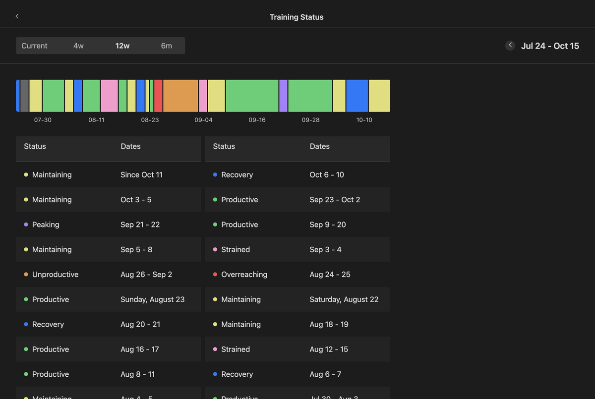
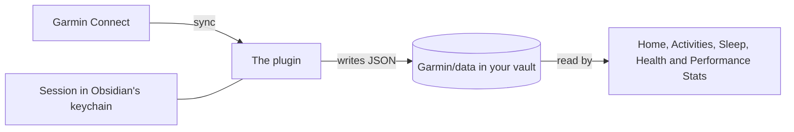

# Garmin Connect for Obsidian

**Garmin Connect inside Obsidian.** 
Sync all your Garmin health, performance and activity data into your vault, and browse it on the built-in dashboard. Compatible on desktop and mobile.

[Install](docs/INSTALLATION.md) · [Guide](docs/GUIDE.md) · [FAQ](docs/FAQ.md) · [Troubleshooting](docs/troubleshooting.md) · [Contributing](docs/CONTRIBUTING.md)

  

> [!IMPORTANT]
> This plugin is not affiliated nor endorsed by Garmin.

## Features

- **Pages:** As of now, we have pages for home, activities, health stats and performance stats. *Most* of these have the full stats details. For anything missing that you think could be a bug or should be included, please submit a [bug report](https://github.com/tareqayz/Obsidian-Garmin-Connect/issues/new?template=bug_report.yml) or [feature request](https://github.com/tareqayz/Obsidian-Garmin-Connect/issues/new?template=feature_request.yml).
- **You own the data:** plain JSON files hold your synced data. This means you can look at stats even offline!
- **Privacy and security:** we respect your privacy and security. This plugin never stores your password, instead storing your session as a `refreshToken` in Obsidian's [Secret Storage](https://docs.obsidian.md/plugins/guides/secret-storage). Learn more about how this plugin handles security [here](https://github.com/tareqayz/Obsidian-Garmin-Connect?tab=security-ov-file).

## Planned features
- **AI Coach/advisor**: Users can opt-in and use a pre-configured or custom-configured model to analyze their data. paste a model API key or enter an Ollama base URL. 
- **Customizable layouts & theming**: The ability to customize layouts and component styles. This plugin hasn't yet been tested with popular themes. Please feel free to contribute some design ideas in [feature request](https://github.com/tareqayz/Obsidian-Garmin-Connect/issues/new?template=feature_request.yml) - ideally pair it with a visual.
- **Embed data within md notes**: beautiful health UI can be directly rendered in your notes. Perfect for a workout journal.

> [!TIP]
> Have any ideas? Please send a [feature request](https://github.com/tareqayz/Obsidian-Garmin-Connect/issues/new?template=feature_request.yml) or learn how to [contribute](https://github.com/tareqayz/Obsidian-Garmin-Connect/blob/main/docs/CONTRIBUTING.md).

## A closer look

<table>
<tr>
<td width="50%"></td>
<td width="50%"></td>
</tr>
<tr>
<td><b>A run's page:</b> the route coloured by pace, stats, laps and charts.</td>
<td><b>All Activities:</b> search, filter and sort everything you've recorded.</td>
</tr>
<tr>
<td></td>
<td></td>
</tr>
<tr>
<td><b>Health Stats:</b> Body Battery's day, with what charged and drained it.</td>
<td><b>Performance Stats:</b> Training Status over the last 12 weeks.</td>
</tr>
</table>

## How it works

The plugin signs in to Garmin Connect, syncs your data into plain JSON files in your vault, and draws
Garmin's pages from those files. So the pages open offline, on every device your vault syncs to. 

## Install

The plugin is in Obsidian's [community plugin directory](https://community.obsidian.md/plugins/garmin-connect).
It needs Obsidian 1.13.0 or later.

1. In Obsidian, open **Settings → Community plugins** and choose **Browse**.
2. Search for **Garmin Connect**, then choose **Install** and **Enable**.

To try betas with BRAT, install by hand or build from source, see [Installation](docs/INSTALLATION.md).

## Get started

Enabling the plugin opens a setup over Home:
1. **Sign in** to your Garmin account. Multi-factor authentication is asked for in the same dialog.
2. **Scan:** a few requests find where your Garmin history starts.
3. **Choose** how much history to keep. Each choice shows its size and how long it takes.
4. **Start:** the history downloads in the background, under an hourly request limit, and carries on
   after a restart.

Then sync with Home's ↻ button, **Sync recent days**, or **Sync on startup**. The
[Guide](docs/GUIDE.md) covers every page and command.

## Storage

Everything is plain JSON in one data folder, `Garmin/data` by default. How much room it takes depends
on how much history you keep. A year of data may vary for individuals, but should be around 50 MB per year on average.

> [!IMPORTANT]
> With Obsidian Sync, turn on **Sync all other types** so the JSON reaches your other devices. 

## Privacy and network use

- **Sign-in flow.** The plugin signs in the way Garmin's mobile app does. Your
  password is used for the sign-in and never stored, and the session stays on the device, in
  Obsidian's keychain, never in the vault.
- **API Calls** at `sso.garmin.com`, `diauth.garmin.com` and `connectapi.garmin.com` (or
  their `garmin.cn` counterparts), to sign in and to fetch your data.
- **Activity maps** draw OpenStreetMap's map under an activity's route, from
  `tile.openstreetmap.org`. That server sees which part of the map you open, roughly where the
  activity was, and each request names this plugin. Turn **Map tiles** off in the settings, and the
  route is drawn on its own with no request at all.
- **`tls.peet.ws`** is asked what your connection looks like, but only when you run the network check
  in **Run diagnostics**.
- **There is no telemetry and no analytics.**
- **Outside the vault** it keeps only the session, a few local-storage keys and a cache of map tiles,
  on each device.

What is stored where, and how it is redacted, is in [Security](docs/SECURITY.md).

## Feedback and support

- **Something broken?** Start with [Troubleshooting](docs/troubleshooting.md).
- **Reporting a bug:** run **Save debug info** and attach the note it opens to the
  [bug report form](https://github.com/tareqayz/Obsidian-Garmin-Connect/issues/new/choose).
- **A security problem:** report it privately through the
  [security advisory form](https://github.com/tareqayz/Obsidian-Garmin-Connect/security/advisories/new).

## Documentation

| Using the plugin | |
| --- | --- |
| [Installation](docs/INSTALLATION.md) | Community plugins, BRAT betas, by hand, a second device, from source |
| [Guide](docs/GUIDE.md) | setup, syncing, what to keep, every page and command |
| [Troubleshooting](docs/troubleshooting.md) | problems by symptom, and the diagnostics |
| [FAQ](docs/FAQ.md) | short answers |
| [Settings](docs/settings.md) | every setting and what it does |
| [Data reference](docs/properties.md) | every file and key the sync writes |
| [Security](docs/SECURITY.md) | what is stored, what leaves your device, reporting a vulnerability |

| Working on the plugin | |
| --- | --- |
| [Contributing](docs/CONTRIBUTING.md) | branches, releases, data versions, local development, writing docs |
| [Architecture](docs/architecture.md) | how the system fits together, with diagrams |
| [Building pages](docs/building-pages.md) | how the pages inside Home work, and how to add one |
| [Garmin API](docs/garmin-api.md) | every endpoint called, sign-in, and the request budget |
| [API catalogue](api/README.md) | the full endpoint list, the recorded shapes and the daily check |
| [Changelog](CHANGELOG.md) | what changed in each release |

## Acknowledgements

- [Garmin Health Sync](https://github.com/fcandi/Garmin-Health-Sync): the inspiration for the
  project, and I *believe* the first Garmin–Obsidian plugin. I took a lot of its ideas, like file
  properties on daily notes, but wanted headless sign-in, cross-platform support and data
  visualisation. I started by seeing if headless authentication was possible and kept building from
  there.
- [cyberjunky/python-garminconnect](https://github.com/cyberjunky/python-garminconnect): an actively
  maintained Garmin Connect library that saved a huge amount of reverse-engineering work.
- [Lucide](https://lucide.dev) (ISC): the watch in the logo and the ribbon icon, and the plugin's
  other icons, through Obsidian.
- [Tabler Icons](https://tabler.io/icons) (MIT): the sport figures on the Activities pages.
- [Leaflet](https://leafletjs.com) (BSD-2-Clause): the activity maps, bundled with the plugin.
- [OpenStreetMap](https://www.openstreetmap.org/copyright): the map under a route, © OpenStreetMap
  contributors, available under the Open Database License.

## License

[MIT](LICENSE) © Tareq Alansari.

Not affiliated with or endorsed by Garmin. Garmin, Garmin Connect, Body Battery and the other Garmin
names are trademarks of Garmin Ltd. or its subsidiaries.
