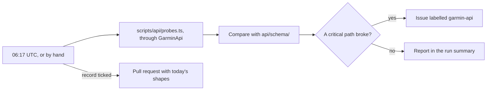

# Garmin API catalogue

Garmin Connect's API is private, with no specification, no version and no deprecation notices: a
field is there one morning and gone the next. This folder answers that with two things. There is a
written-down description of the API, and a job that checks it against the live one every day.

**Code:** `scripts/api/` (the check, the probes, the shape language), `.github/workflows/api-contract.yml`.

| File | What it is |
| --- | --- |
| [`endpoints.json`](endpoints.json) | Every endpoint, its request shape, and what this plugin does with it. |
| [`schema/`](schema/) | The response shapes actually observed, one file per endpoint that has answered with data (format: [`schema/README.md`](schema/README.md)). |

To count them:

```bash
jq '.endpoints | length' api/endpoints.json                              # every endpoint
jq '[.endpoints[] | select(.check == true)] | length' api/endpoints.json # checked daily
jq '[.endpoints[] | select(.source == "plugin")] | length' api/endpoints.json # seen only in Garmin's own traffic
```

## endpoints.json

The request half of most entries is **generated** from
[`cyberjunky/python-garminconnect`](https://github.com/cyberjunky/python-garminconnect) by
`scripts/api/extract-endpoints.py`. The script reads that library's AST and folds its URL
expressions back into path templates. That library is the closest thing Garmin has to a spec,
because the people who keep it current notice when it breaks.

The other entries are routes upstream doesn't know, seen in the Garmin Connect app's and web app's
own traffic: GraphQL queries, and most of what the Health and Performance Stats pages call. They
carry `"source": "plugin"`, which stops a regeneration from marking them retired, and their
`upstream.summary` says where they were seen.

```jsonc
{
  "id": "user-summary",
  "method": "GET",
  "path": "/usersummary-service/usersummary/daily/{displayName}",
  "service": "usersummary-service",
  "tier": "connectapi",
  "pathParams": ["displayName"],
  "query": ["calendarDate"],
  "requestBody": false,
  "returns": "json",
  "upstream": { "method": "get_user_summary", "summary": "…", "args": ["cdate"], "line": 963 },

  // Everything below here is hand-written and survives regeneration.
  "plugin": "GarminApi.dailySummary",
  "groups": ["activity", "heart", "stress", "respiration", "spo2"],
  "cadence": "day",
  "check": true,
  "critical": ["calendarDate", "totalSteps", "…"],
  "schema": "schema/user-summary.json",
  "notes": "Serves five metric groups from one request."
}
```

Two lists say what the plugin does with a response. `[]` descends into array items, so
`[].generic.vo2MaxPreciseValue` reaches into each day of a range response.

- **`critical`:** paths the plugin depends on. Losing one fails the daily check.
- **`reads`:** paths it reads but tolerates missing; the result is a property that doesn't appear,
  not a sync that breaks. Reported, never fatal. A field name taken from documentation rather than
  observed belongs here too, until a live recording confirms it.

Losing anything outside both lists is a warning at most. A range entry's `notes` also give the
longest span Garmin takes, probed live, because the caps differ by route. They also say what an
empty answer looks like.

### Regenerating

```bash
GARMINCONNECT_SRC=~/Dev/python-garminconnect npm run api:extract
npm run api:extract:check   # exits 1 if the catalogue has drifted from upstream
```

CI runs `--check` daily against a fresh clone of upstream. It is advisory: upstream adding an
endpoint doesn't break this plugin, but it is the earliest warning that Garmin moved something. An
endpoint that disappears upstream is kept and marked `"status": "gone-upstream"`, because a path
Garmin retired is exactly the news this file exists to carry.

## The daily check

`.github/workflows/api-contract.yml` runs every morning at 06:17 UTC. It drives the plugin's own
`GarminApi`, not a parallel HTTP client, so a path, header or parameter that stops working here is
one that stops working in the plugin.



- **What it asks for:** every endpoint with `check: true`, sampling the last three complete days and
  a fourteen-day range. The weekly routes ask for their usual 52 weeks, and so do the weight and
  blood-pressure ranges: the weekly forms accept no other span, and a rare weigh-in needs the
  wider net.
- **It includes routes nothing calls yet:** the weekly, monthly and latest forms of routes the pages
  read another way, and routes for pages still to be built. Until they are wired up or unchecked, the
  check spends a request on each. They are listed in
  [Garmin API → Available but unused](../docs/garmin-api.md#available-but-unused).

Each endpoint comes back with one verdict:

| | Verdict | Meaning |
| --- | --- | --- |
| `✓` | `ok` | Today's response fits the recorded shape. |
| `!` | `warn` | Something changed, but not on a path the plugin reads. |
| `✗` | `fail` | A `critical` path is gone, or changed into something incompatible. |
| `·` | `no-data` | Every sample came back empty. A rest day, not a change. |
| `+` | `new` | Nothing recorded yet. Run `npm run api:record`. |
| `✗` | `error` | The request itself failed. |

A failure opens a single issue labelled `garmin-api`, or comments on the one already open.

### Why it stays quiet

A recorded shape is a **union over time**, not a snapshot, and the comparison is deliberately
one-directional.
- **Not news:** a field merely absent today, or a `number | null` that happens to be a number today.
- **News:** a field the recording says is *always* there and is now gone, or a type never seen
  before.

Without that asymmetry the check would fire on every quiet day, and everyone would learn to ignore
it.

`critical` paths get a third status besides present and absent: **present but always null**. A
property that is there and forever empty is the signature of reading the right endpoint with the
wrong field name.

## Setting it up

The check needs a Garmin session. Mint one locally; the password never leaves your machine and is
never written down:

```bash
npm run api:token                       # prompts, handles MFA
gh secret set GARMIN_TOKENS < .garmin-token.json
```

`.garmin-token.json` is written `0600` and is gitignored. It holds a refresh token, not a password.

- **`GH_SECRETS_TOKEN`:** set it to a fine-grained PAT with **Secrets: write** on this repository.
  Garmin may hand back a new refresh token when the old one is used. With that PAT the workflow
  saves it back to the secret; without it, a rotation strands the next run on a token Garmin has
  retired. Re-run `npm run api:token` if that happens.
- **`GARMIN_EMAIL` and `GARMIN_PASSWORD`:** they work too, but don't store the password as a secret.
  A non-interactive run can't answer MFA, and repeated sign-ins are what Garmin rate-limits and
  locks accounts over.

What the run exposes:
- **The report** goes to the run's log and step summary, which are public on a public repository,
  and into an issue when a contract breaks. It holds field names and types only. Error messages are
  scrubbed of emails, tokens and IP addresses, and the account's names become `[name]`.
- **The job that gets the secrets** installs with `npm ci --ignore-scripts`, so no package's install
  script runs beside them. The actions are pinned to commit SHAs.
- **With no secret at all** the live job skips rather than fails, so a fork stays green.

## Running it yourself

```bash
npm run api:check                  # verify; exit 1 if a contract broke
npm run api:record                 # fold today's answer into schema/
npm run api:check -- --rerecord    # throw the history away and start from today
npm run api:check -- --days 7 --range 90
npm run api:check -- --strict      # exit 1 on any change, not just a broken one
```

Credentials come from the same environment variables. `.garmin-token.json` isn't read
automatically, so pass it explicitly:

```bash
GARMIN_TOKENS="$(cat .garmin-token.json)" npm run api:check
```

## Measuring the rate limit

`npm run api:ramp` finds how fast Garmin lets the plugin ask, and stops at the first sign it
objects. That is how the sync speeds in [Garmin API](../docs/garmin-api.md#request-pace) were
chosen.

```bash
GARMIN_TOKENS="$(cat .garmin-token.json)" npm run api:ramp -- --save-token .garmin-token.json
npm run api:ramp -- --stages 1x3,2x6,4x9 --stage-seconds 60 --cooldown 120
```

Without a fresh token, run it inside Obsidian on the plugin's own session: `npm run api:ramp:eval`,
then follow the header of `scripts/api/ramp-eval.ts`. Either way, pause the plugin's syncing while
it runs, and expect a long wait before the next sync if it does hit a 429.

## Accepting a change

When Garmin changes something and the change is fine:
1. Read the report, on the issue or in the run summary.
2. If the plugin needs to follow the change, fix `src/` first.
3. Re-run the workflow with the **record** input ticked. It folds today's shapes into `api/schema/`
   and opens a pull request, so the new baseline is reviewed rather than assumed.

If a `critical` path turns out to have been wrong all along, the plugin reading a key Garmin never
sent, correct `critical` in `endpoints.json` to what is really there. `tests/api-catalogue.test.ts`
checks every `critical` path against the recorded shape, so a typo there fails offline, on the pull
request, without an account.

## Adding an endpoint to the check

1. Add the wrapper to `src/garmin/endpoints.ts`.
2. In `endpoints.json`, set `plugin`, `check: true`, `critical` and `schema` on its entry. A route
   upstream doesn't have needs a new entry with `"source": "plugin"`.
3. Add a probe to `scripts/api/probes.ts` under the same id.
4. Run `npm run api:record` once to lay down the baseline. Without a token, save a few responses
   through the running plugin with `scripts/dev/live-api.sh`, then run
   `npm run api:record-file -- <id> <response.json>…`.

Steps 2 and 3 have to agree. `tests/api-catalogue.test.ts` fails if an endpoint is marked
`check: true` with no probe, or the other way round. The failure it prevents is silent: an endpoint
that is never actually fetched.
