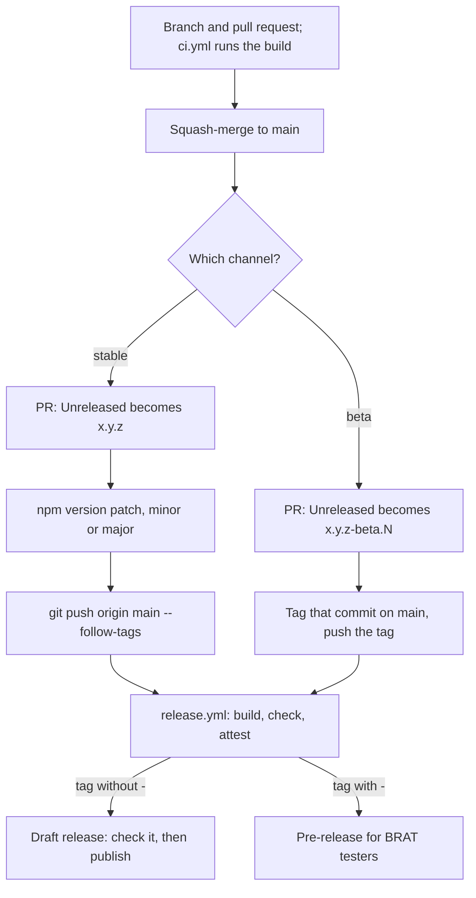

# Contributing

How to work on the plugin: set up, branch and commit, release, version the data, and keep the docs
true. How the code fits together is in [Architecture](architecture.md) and
[Building pages](building-pages.md).

## Quick start

```bash
git clone https://github.com/tareqayz/Obsidian-Garmin-Connect.git
cd Obsidian-Garmin-Connect
npm install
npm run dev     # watch build
npm test        # the suite: no network, no Obsidian
npm run build   # tsc → svelte-check → tests → production bundle → mobile-safety check
npm run lint    # the Community directory's review rules
```

`npm run build` is the gate CI runs. Its last step, `scripts/check-mobile-safe.mjs`, fails if a node
or electron import reaches `main.js`. That check is what backs `isDesktopOnly: false`: fix the
import, not the check.

`npm run lint` runs `eslint-plugin-obsidianmd`'s recommended rules, the ones the Community directory's
automated review lints every release with, and CI runs it beside the build. `eslint.config.mjs`
ignores what the directory's scanner ignores, and `src/tsconfig.json` types the plugin's code the
way the scanner does, without Node's globals: `@types/node`, there for `scripts/` and `tests/`,
would otherwise give every array ES2022's `.at()`, which the ES2020 lib lacks and the review reports
as untyped. svelte-check reads the same file. Don't silence a rule with a disable comment: the
review doesn't honour them all. Two things only the lint catches: a `<style>` or `<link>` the code
adds to the page (CSS belongs in `styles.css`), and `any` reaching typed code.

The review checks `styles.css` too: no `!important`, no property set twice in one rule, and nothing
that Obsidian's browser supports only in part. `tests/leaflet-styles.test.ts` runs the first two;
only the review runs the third.

## Branches and commits

`main` is the only long-lived branch. Every change is a short-lived branch named after its outcome,
merged by pull request:

| Prefix | For |
| --- | --- |
| `feature/<slug>` | new capability |
| `fix/<slug>` | a bug fix |
| `chore/<slug>` | tooling, dependencies, CI |
| `docs/<slug>` | documentation only |
| `refactor/<slug>` | no behaviour change |

- **Commits:** [Conventional Commits](https://www.conventionalcommits.org) (`feat:`, `fix:`,
  `chore:`, `docs:`, `refactor:`, `test:`).
- **Merging:** pull requests squash-merge, so `main` gets one commit per pull request. Delete the
  branch after the merge.
- **Committing to `main`:** never directly. The one exception is the version commit that
  `npm version` makes for a stable release.
- **No `staging`, `develop` or `hotfix/*`, on purpose.** A plugin has no servers to stage into, and
  the beta channel already puts a change in front of some users first. An urgent fix is a `fix/*`
  branch, released as a patch.

## Continuous integration

| Workflow | Runs | Does |
| --- | --- | --- |
| `.github/workflows/ci.yml` | every pull request, every push to `main` | `npm ci`, `npm run lint` and `npm run build` |
| `.github/workflows/api-contract.yml` | daily at 06:17 UTC, by hand, and on pull requests that touch the API | the catalogue's offline checks on every run; the live contract check against Garmin daily and by hand, never on pull requests (see [api/README.md](../api/README.md)) |
| `.github/workflows/release.yml` | every pushed tag | builds, checks the tag against the manifest, attests, then drafts (stable) or publishes (beta) a release |

## Releasing

Both channels are driven by the tag alone; `release.yml` tells them apart by whether the tag
contains a `-`. Either way, the release's notes are its section of [CHANGELOG.md](../CHANGELOG.md),
so add to `[Unreleased]` as changes land.



### Stable: community-directory users

1. In a pull request, rename `## [Unreleased]` to `## [x.y.z] — YYYY-MM-DD`. Sum up everything since
   the last stable there, leaving the beta sections below it. Add a fresh, empty `## [Unreleased]`
   and update the compare links at the foot. Merge it: `npm version` refuses a dirty working tree.
2. In the directory's dashboard, run **Review branch → Run preview scan** on `main`. It runs the
   checks a release gets, without making one; fix what it finds before tagging.
3. On `main`:
   ```bash
   npm version patch|minor|major     # bumps package.json; version-bump.mjs syncs manifest.json and
                                     # versions.json; commits; tags with no "v" prefix
   git push origin main --follow-tags
   ```
4. The workflow builds, checks that the tag matches `manifest.json`, and attests the files. It then
   opens a **draft** release with `main.js`, `manifest.json` and `styles.css` attached and the
   version's section as its notes. Check it, then publish.

### Beta: BRAT testers

1. In a pull request, rename `## [Unreleased]` to `## [x.y.z-beta.N] — YYYY-MM-DD`, add a fresh
   `## [Unreleased]`, and update the compare links. Merge it.
2. On the merged `main`, check the notes: `npm run --silent release:notes -- x.y.z-beta.N` should
   print the beta's section. Check now: a beta is published as soon as its tag is pushed.
3. Tag the merged commit and push the tag:
   ```bash
   git tag -a x.y.z-beta.N -m "x.y.z-beta.N"
   git push origin x.y.z-beta.N
   ```

The workflow stamps the version into `manifest.json` **inside the runner** and publishes a
pre-release. The bump is never committed: Obsidian reads `manifest.json` at the head of the default
branch, so a committed beta version would ship to every directory user. Testers install betas by
adding `tareqayz/Obsidian-Garmin-Connect` in BRAT.

### Release notes

`npm run --silent release:notes -- <tag>` (`scripts/release/`) prints what a release carries. It
takes the first section that has content, in this order:
1. `## [<tag>]`;
2. `## [x.y.z]`, the tag without its pre-release part;
3. `## [Unreleased]`.

With none, the workflow falls back to GitHub's generated notes and warns.

> [!WARNING]
> Never add `## [x.y.z]` before you tag that stable: every later beta of x.y.z would publish its
> notes. That is how `0.2.0-beta.2` shipped with `0.2.0-beta.1`'s notes.

The parser is strict:
- **Headings:** a section heading is exactly `## [name]` at the start of a line, followed by the end
  of the line or a space (`## [1.2.0] — 2026-12-01`).
- **Where a section ends:** at the next line starting `## `, or at a link definition such as
  `[1.2.0]: https://…`. So put link definitions only at the foot of the file, and use inline links in
  a section.
- **Links and images inside a section** must be absolute URLs: a release page can't resolve relative
  ones.
- **An empty section,** one holding only `###` headings, counts as empty and falls through to the
  next candidate.

### Rules worth not relearning

1. **The tag equals `manifest.json`'s `version`, with no `v` prefix.** `.npmrc` sets
   `tag-version-prefix=""`, because npm's default `v` would break every install.
2. **The committed `manifest.json` version is always plain `x.y.z`.** `version-bump.mjs` refuses
   anything else.
3. **Release assets are `main.js`, `manifest.json` and `styles.css`,** attached one by one: Obsidian
   can't read a zip.
4. **`versions.json` maps a plugin version to its `minAppVersion`,** and needs a new entry only when
   `minAppVersion` moves; `version-bump.mjs` handles it. It is empty until the first stable release.
5. **Submission is through [community.obsidian.md](https://community.obsidian.md),** with an Obsidian
   account and a linked GitHub account, not a pull request to `obsidian-releases`.
6. **`manifest-beta.json` is obsolete.** BRAT 1.1.0 and later read betas straight from GitHub
   pre-releases; don't add one back.
7. **Obsidian doesn't implement full semver precedence.** A tester on `1.2.0-beta.1` isn't offered
   `1.2.0`, and stays on the beta until `1.2.1`. Tell testers to update through BRAT, or graduate a
   beta as the next patch.

## Data versions

A vault keeps what it downloaded. So a release that stores new data for days or activities a vault
already holds has to fetch them again, and ask first. Such a change:

1. **Bumps the data set's version:**
   - Day details: `DAY_DETAILS_VERSION` (`src/sync/datasets.ts`);
   - Activity details: `ACTIVITY_DETAIL_VERSION` (`src/sync/activity-detail.ts`), which
     `ACTIVITY_DETAILS_VERSION` follows;
   - a chart history: the index's own `version`. For the three older indexes that is
     `INDEX_VERSION` (`activity-index.ts`), `DAILY_STATS_VERSION` (`daily-stats.ts`) or
     `SLEEP_INDEX_VERSION` (`sleep-index.ts`).
2. **For Day details or Activity details, adds a line to the set's `changes`** in `datasets.ts`,
   keyed by the new version. That line is what the update dialog says about the data an older
   version saved. A chart history needs none: the dialog names it "`<Title>` history".
3. **Runs `UPDATE_SHAPES=1 npm test`** to record the new shape in
   `tests/fixtures/dataset-shapes.json`, and commits it with the change.

A bumped version is a consent key the vault hasn't seen (`days@2`, `index:stress@2`). So the first
Garmin view after the update asks once, in **New data for your history**. Without the bump, only the
days synced from then on get the new data.

- **What the shape test catches.** `tests/dataset-shapes.test.ts` snapshots what each store keeps
  beside its version: Day details' endpoints and series blocks, an activity page's blocks, and each
  day index's columns. It fails when one changes without a bump.
- **What it misses.** It records nothing for `activities`, `daily-stats` and `sleep`, and can't see a
  new property mapped from an endpoint already called: bump by hand when the days already held should
  get it. Running `UPDATE_SHAPES=1` without a bump re-records the shape silently.
- **A bump needn't throw a file away.** An activity file of the previous version can be read as the
  new one, with only the blocks the bump changed left to fetch (`upgradeRun` and `CHANGED_IN_6` in
  `activity-detail.ts`).

## Local development

The maintainer's working copy is the live plugin folder, `.obsidian/plugins/garmin-connect`, inside
a real vault. That has consequences:
- **A build replaces the live plugin's `main.js`.** Hot Reload isn't enabled, so nothing changes in
  the running app until `obsidian plugin:reload id=garmin-connect` (see
  [obsidian-cli.md](obsidian-cli.md)). A load also runs a sync when **Sync on startup** is on. The
  vault lives in iCloud, so the new `main.js` reaches the phone too.
- **Parallel work goes in a `git worktree` outside iCloud,** not in a second branch checked out
  here: switching branches in place changes the source the next build uses.
- **Secrets and personal data live beside the code.** Never commit, print or paste them:
  - `data.json`: the plugin's settings, including the account email. Builds before the keychain
    session also kept tokens there. It is gitignored.
  - `.garmin-token.json`: a refresh token, written by `npm run api:token`.
  - `ref/`: the phone screenshots and specs the page pipeline works from: personal health data that
    stays on the machine that captured it.
- **Never test a beta install against the primary vault.**
- **`node_modules` stays out of iCloud** through File Provider's ignore attribute:
  `xattr -w 'com.apple.fileprovider.ignore#P' 1 node_modules`. `npm ci` recreates the folder, so
  re-apply it after one.

### npm scripts

| Script | Does |
| --- | --- |
| `dev` | esbuild in watch mode |
| `build` | the full gate: `tsc`, `svelte-check`, `test`, the production bundle, `check` |
| `check` | `scripts/check-mobile-safe.mjs`: fails if a node or electron require reached `main.js` |
| `lint` | ESLint with the Community directory's rules (`eslint.config.mjs`) |
| `test` | bundles `tests/*.test.ts` into `tests/.build/` (cleared first) and runs Node's test runner |
| `svelte-check` | type-checks the Svelte components |
| `version` | npm's version hook: `version-bump.mjs` (see [Releasing](#releasing)) |
| `release:notes` | prints a tag's release notes from `CHANGELOG.md` |
| `api:extract`, `api:extract:check` | regenerate the request half of `api/endpoints.json` from a `python-garminconnect` checkout, or check it hasn't drifted |
| `api:check`, `api:record` | the live contract check, and the same folding today's shapes into `api/schema/` |
| `api:record-file` | record shapes from saved responses, without a token |
| `api:token` | sign in once and write `.garmin-token.json` for the contract check |
| `api:ramp`, `api:ramp:eval` | measure how fast Garmin lets the plugin ask, from Node or inside Obsidian |
| `iphone:build` | builds `scripts/iphone/`'s helper, used to OCR phone screenshots |

The `api:*` scripts are described in [api/README.md](../api/README.md).

### Development scripts

`scripts/dev/` drives the running app and the Garmin web app. The page pipeline and its agents use
these scripts, and they work as well by hand:

| Script | Does |
| --- | --- |
| `ev.sh '<js>'` | `obsidian eval` with retries, because the CLI drops its output now and then |
| `click.sh '<js returning an element>'` | a real click through the Chrome DevTools Protocol; run `obsidian dev:debug on` first |
| `capture-view.sh` | captures an open Home view at a route, at phone (402) or pane (1190) width, light or dark |
| `live-api.sh` | calls Garmin through the running plugin's own client, read-only, and saves the response |
| `b.sh` | gstack's browser for the Garmin web app (needs gstack's `browse`), read-only commands only |
| `compare.py` | stitches captures and lays a page beside its reference; needs Pillow |
| `test.sh '<glob>'` | runs only the matching tests, in `tests/.build-<slug>/`, so parallel runs don't collide |

`scripts/garmin-web/` holds what `b.sh` injects into the web app (the GraphQL recorder, the page
text), and `summarize.mjs`, which turns a web capture into an endpoint inventory.
`scripts/iphone/mirror.sh ocr-file` OCRs screenshots taken on the phone.

### Rebuilding a Garmin page

New Garmin screens go through the `/garmin-page` pipeline:
1. capture the phone and the web app;
2. write the spec;
3. build the 1:1 Garmin page and its Obsidian twin in Figma;
4. implement it, verify it in the live vault, and commit.

Its instructions are in [.claude/skills/garmin-page/SKILL.md](../.claude/skills/garmin-page/SKILL.md).
The design source is the [Obsidian Garmin Figma file](https://www.figma.com/design/8D338zFIJ1a2zrsuligjva/Obsidian-Garmin),
and UI changes are designed there first.

## Writing docs

The docs drift when one fact lives in several places. So each topic has one home, and every pull
request that changes behaviour updates that home in the same pull request.

| Topic | Home |
| --- | --- |
| What it is, quick start, the disclosures the directory policies require | `README.md` |
| Installing | `docs/INSTALLATION.md` |
| Using it: setup, syncing, data sets and their sizes, the history download, the pages, commands | `docs/GUIDE.md` |
| Every setting, `data.json` key and metric-group cost | `docs/settings.md` |
| Every file and key the sync writes | `docs/properties.md` |
| What is stored where, what leaves the device, removal | `docs/SECURITY.md` |
| Problems by symptom, diagnostics | `docs/troubleshooting.md` |
| Short answers that link to the above | `docs/FAQ.md` |
| How the system works | `docs/architecture.md` |
| How pages are built | `docs/building-pages.md` |
| Garmin's endpoints, sign-in and request budget | `docs/garmin-api.md` |
| The endpoint catalogue and its daily check | `api/README.md` |
| Branches, releases, data versions, local development | `docs/CONTRIBUTING.md` |

**Writing:**
- **Open each page with what it answers.** A developer doc adds a `Code:` line naming the files it
  describes. Keep paragraphs short, and use tables for lookups, numbered lists for procedures and
  bullets for facts. Headings are in sentence case and unnumbered.
- **Write code names in full, in backticks, with their file,** so `grep` finds them. In a developer
  doc, name the constant rather than copying its value. Quote UI labels exactly, in bold.
- **Don't rename a heading that something links to** unless you update every link to it.
- **Mermaid diagrams** use only `flowchart`, `sequenceDiagram` and `stateDiagram-v2`, with about 12
  nodes at most and no styling or init blocks, so they render in GitHub's light and dark themes and
  in Obsidian. The text before a diagram must say the same thing.
- **Use GitHub alerts** (`> [!NOTE]`, `> [!WARNING]` …) at the top level, with the marker alone on
  its line, and `<details>` only for depth few readers need.

<details>
<summary>Before the first directory submission</summary>

Each of these would fail the automated review, or the guidelines it checks:

- [x] `manifest.json`'s `name` has no `(probe)`.
- [x] Its `description` is user-facing: under 250 characters, opens with a verb, ends in a period, and
      doesn't say "Obsidian".
- [x] `minAppVersion` is honest: 1.11.4, for SecretStorage (`app.secretStorage`), which keeps the
      Garmin session in the keychain.
- [x] `isDesktopOnly: false` still holds: `scripts/check-mobile-safe.mjs` runs in `npm run build`,
      and CI runs that on every pull request.
- [x] `release.yml` can create releases: it asks for `contents: write`, and it has published every
      beta.
- [x] The README discloses what the developer policies require: that a Garmin account is needed, and
      what the plugin sends over the network and why.
- [x] Settings headings use `setHeading()` rather than raw heading elements.
- [ ] `version` bumped to `1.0.0`.
- [ ] UI text in sentence case throughout: commands, settings, notices.

`id` is already valid: lowercase and hyphens only, no `obsidian`, no `plugin` suffix.

</details>
