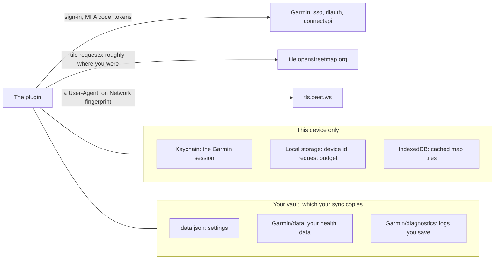

# Security

This plugin holds a session for your Garmin Connect account and writes health data into your vault.
This page says exactly what is stored where, what leaves your device, and what to be careful about.

## What is stored, and where

Your session stays on the device, in Obsidian's keychain. Your settings and health data are files in
the vault, so they travel wherever your vault does. The plugin sends requests only to Garmin, to
OpenStreetMap for map tiles, and to `tls.peet.ws` when you run the diagnostics' network check.

### The session: Obsidian's keychain

The Garmin session is kept in Obsidian's keychain on each device (**Settings → Keychain**, the secret
`garmin-connect-session`), not in the vault. Obsidian keeps the keychain in that device's local
storage for the vault, so the session never travels with a vault sync, a backup or a repository of
the vault.

| Stored in the keychain | Not stored anywhere |
| --- | --- |
| the OAuth2 **refresh token** | your **password** |
| the DI client ID that token belongs to, and when it was saved | the access token, which lives in memory only |

**Your password is never written anywhere.** It is used for the sign-in and dropped. After a restart
the access token is minted again from the refresh token.

### Settings: `data.json`

The plugin's settings live in `data.json`, inside your vault's `.obsidian/plugins/garmin-connect/`.
It holds:
- every setting, including the account email;
- when the setup ran and what you agreed to download;
- Home's state.

It holds no token. It is read by a narrow allowlist, so a stray value can't survive the next save. A
session that an older release left in it moves to the keychain on load and drops out of the file.

### Your health data: the data folder

The sync writes into the vault itself, under the data folder (`Garmin/data` by default), and writes
no notes. The full list of files and keys is the [Data reference](properties.md). What matters for
privacy:

| What | Where | Holds |
| --- | --- | --- |
| Day files and series files | `days/`, `series/` | each day's numbers, and its heart rate, stress, Body Battery and sleep curves |
| History indexes | `activities/`, `daily-stats/`, `sleep/` and one folder per stat | your activities, and a row a day of each metric's history |
| Activity details | `activity-details/<id>.json` | **your GPS route: where you ran, rode or swam.** Also the samples, laps, zones, weather, gear, badges, the watch and its firmware, the sensors by name (never a serial number), and your weight on that day, for W/kg |
| Account file | `account.json` | your full name and display name, avatar URLs, sex, your watch's name and last upload, lactate threshold, FTP per sport (with the weight and date behind its W/kg), running economy, cycling ability, training plans, upcoming events and personal records |
| Bookkeeping | `scan.json`, `backfill.json`, `sync-state.json`, `days/index.json`, `activity-details/index.json` | where your Garmin history starts, your activity count, the watch's last upload, which device runs the history download (a random id and a name such as "Mac"), and which days and activities the vault holds |

`account.json` never holds the sign-in email or a token. Garmin's `userName` is the sign-in email, so
it is deliberately left out.

> [!WARNING]
> This is health data, and it travels wherever your vault travels. Treat a vault with the data folder
> in it the way you would treat a medical record.

### On the device, outside the vault

Besides the keychain entry, the plugin keeps a few things in the device's own storage. None of them
syncs:
- **Local storage:** `garmin-connect-device` (a random id for the history download's lease),
  `garmin-connect-budget` (the last hour's requests), `garmin-connect-had-session` and
  `garmin-connect-hide-sign-in` (which Home card to show).
- **IndexedDB `garmin-connect-map-tiles`:** the map tiles this device drew. They are kept for at least
  a week, or as long as the server allows, so a map opened again asks for nothing. At most 2,500
  tiles are kept; the least recently drawn go first.

## The refresh token is durable account access

This is the part worth taking seriously. The refresh token can mint new access tokens for your
Garmin account. It stays in the device's keychain, so a copy of your vault doesn't hold it, but
anyone with access to the device's Obsidian does.

- **Sign out from settings** when you have finished with a device. That empties the keychain entry.
  It doesn't contact Garmin.
- **One session per device.** Each device signs in on its own and refreshes its own token. Signing
  out on one leaves the others signed in.
- **Releases up to 0.2.0-beta.2 kept the token in `data.json`.** If you shared or committed a vault
  while on one of them, treat that token as exposed: signing out clears only this device's copy,
  and the plugin has no way to revoke a token at Garmin.

## Removing the plugin and its data

- **Uninstalling deletes `data.json`** with your settings, because Obsidian deletes the plugin's
  folder.
- **The data folder stays.** It is part of your vault, not the plugin.
- **The device you uninstall from tidies up.** It notices within about 15 seconds that the plugin's
  folder has gone, then:
  - clears its keychain entry, local-storage keys and map-tile cache, without contacting Garmin;
  - while the data folder still holds the plugin's files, asks once whether to **Keep data** or
    **Move to trash**, with a box to remove the diagnostics notes too.

  Nothing asks when the plugin's folder is deleted by hand, or the plugin is uninstalled on another
  device: delete the data folder yourself.
- **Settings → Danger zone → Delete synced data** moves the plugin's own files in the data folder to
  the trash, and the diagnostics notes if you tick the box. Anything else in that folder stays. It
  doesn't sign you out.
- **The trash still holds them.** Files in the system trash or the vault's `.trash` folder stay on
  the disk until it is emptied, and a vault sync or a backup may keep copies of its own.

## What leaves your device

| Destination | When | What it receives |
| --- | --- | --- |
| `sso.garmin.com` | signing in | your email and password, then your MFA code if Garmin asks for one |
| `diauth.garmin.com` | signing in, and refreshing the session | the service ticket; later the refresh token and its DI client ID |
| `connectapi.garmin.com` | syncing, and pages loading what they need | the bearer token, and the dates and ids being asked for |
| `tile.openstreetmap.org` | drawing an activity's map, while **Map tiles** is on | requests for the tiles around the route (so roughly where the activity was) and a User-Agent naming this plugin |
| `tls.peet.ws` | only when you run **Network fingerprint** in the diagnostics | a User-Agent string |

Like any server, each of these also sees your IP address. `tls.peet.ws`, a third-party echo service,
also sees what your connection looks like (its TLS fingerprint): that is what it is for, and it is
never contacted during a sync. Accounts on Garmin's China service (`garmin.cn`) use the same hosts
under that domain.

The pages load no scripts from anywhere, and no images but the map tiles. A few pages link to Garmin
Connect's website or a health reference; those open in your browser only when you click them. There
is no telemetry and no analytics.

## Diagnostics logs

**Run diagnostics** can save a run as a note in your vault, because a phone has no console and a note
syncs back to your desktop. The folder is the **Log folder** in the Advanced settings
(`Garmin/diagnostics` in a new vault). A run is saved only when you press **Save to vault**, unless
**Save every diagnostics run to the vault** is on, which it isn't by default.

**Copy debug info** gathers what a bug report needs, with no network request and no sign-in:
versions, platform, the settings without the email, the history download's state, the last sync
with its warnings, request counts and what the data folder holds. Where there is no clipboard, it
saves a note in the **Log folder** instead.

Both are **redacted before anything is written or copied:**
- Email addresses are masked to their first three characters and their domain.
- Tokens keep their first 10 characters and their length: enough to tell runs apart, not enough to
  use. Service tickets aren't logged at all.
- IP addresses are masked whole.
- Your display name and account id are replaced with placeholders in request paths and error
  messages.
- The fitness check prints field names and types, not values. The session check says whether steps
  and resting heart rate came back, not what they were.

They are still about your account. Read one before pasting it into an issue.

## Account lockout

Garmin limits login attempts per IP and **can lock an account after repeated failures.**
- Sign in deliberately, never in a retry loop.
- On a 429, wait 15–30 minutes.
- In the diagnostics, **Test login** costs a real login attempt every time, and **Test session
  persistence** costs one when there is no saved session. **Network fingerprint** and **Inspect
  fitness endpoints** cost none.
- `BAD-CREDENTIALS` means stop and fix the credentials, not retry.

## Network handling

- **All Garmin traffic is HTTPS.**
- **The display name is URL-encoded** before going into a request path, so a hostile or corrupted
  profile can't inject path segments.
- **A `privacyProtected` daily summary** is dropped with a warning rather than read as an empty
  day.
- **No external scripts.** The charts are hand-drawn SVG, and the activity maps' Leaflet is bundled,
  not fetched.
- **`npm run build` fails** if a node or electron import reaches the bundle.

## For contributors

Working on the plugin puts a few more secrets within reach. None of them may be committed, printed or
pasted:
- **`.garmin-token.json`,** written by `npm run api:token` for the API contract check. It is a
  refresh token, written with owner-only permissions and gitignored.
- **The contract check's CI secrets:** `GARMIN_TOKENS` (the token file's contents) and
  `GH_SECRETS_TOKEN` (a fine-grained token with "Secrets: write", so the workflow can save a rotated
  refresh token back). `GARMIN_EMAIL` and `GARMIN_PASSWORD` also work, but don't set them: a stored
  password is the one secret worth not having. Without any of them the live check skips. See
  [api/README.md](../api/README.md#setting-it-up).
- **`data.json` in a development vault** holds that vault's settings, and **`ref/`** holds the phone
  screenshots and specs the page pipeline works from. Both are personal and gitignored.

## Reporting a vulnerability

Please **don't open a public issue** for a security problem. Report it privately through GitHub's
[security advisory form](https://github.com/tareqayz/Obsidian-Garmin-Connect/security/advisories/new),
so it can be fixed before anything is disclosed.

Useful things to include: what an attacker would gain, the conditions needed, and a redacted
diagnostics log if the network layer is involved. Please redact tokens even though the logger does.

Expect an acknowledgement within a week. This is a spare-time project, so a fix may take longer,
but you will be kept informed.

## Supported versions

Only the latest release is supported. Fixes ship forward in a new release rather than being
backported.
