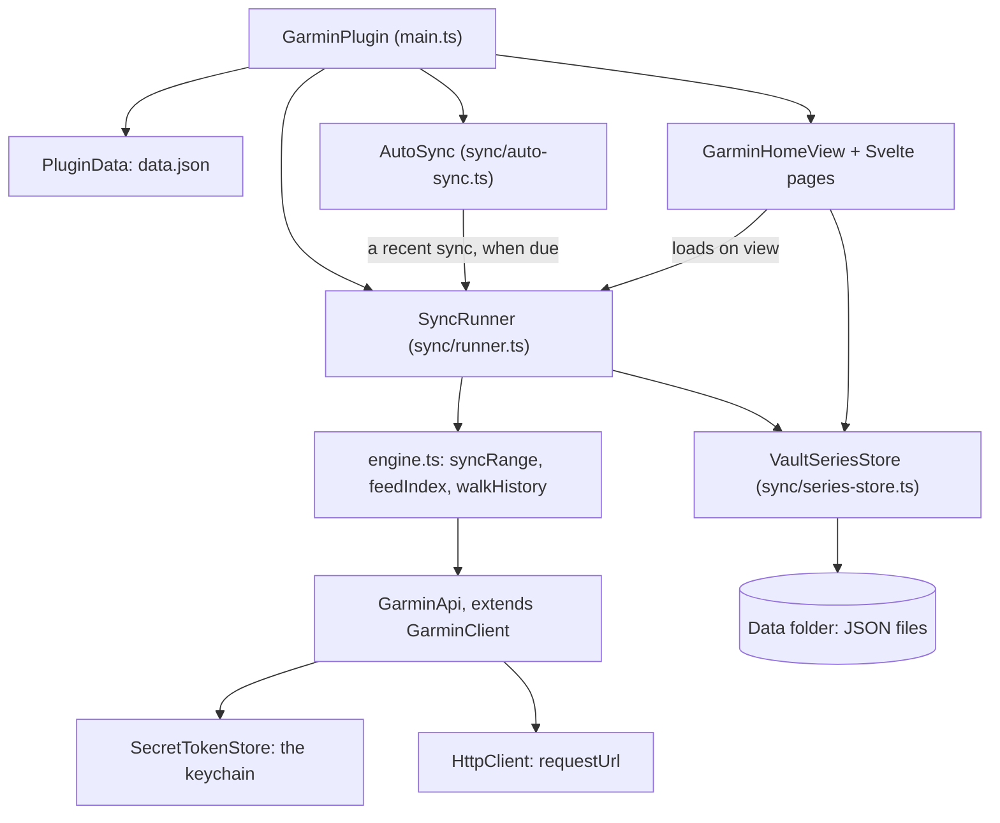
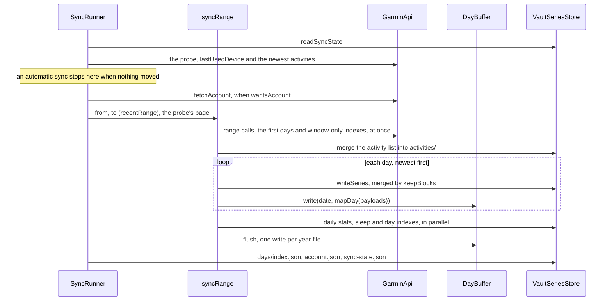
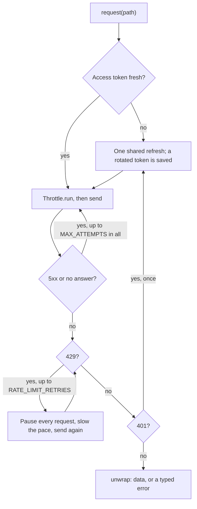
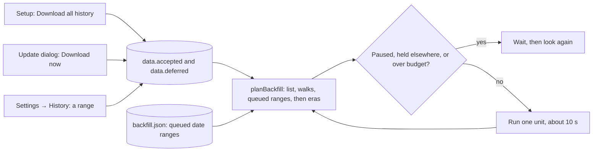

# Architecture

How the plugin is put together and why, for contributors and coding agents. What it does for a user
is in the [Guide](GUIDE.md); how the pages inside Home are built is in
[Building pages](building-pages.md).

**Code:** `src/main.ts` (entry), `src/garmin/` (talking to Garmin), `src/sync/` (syncing, storage,
the history download), `src/dashboard/` and `src/ui/` (pages and dialogs).

## Overview

`GarminPlugin` (`src/main.ts`) builds four things on load:
- a Garmin client, with the session from Obsidian's keychain;
- a `SyncRunner`, which runs every sync, history walk and on-view load;
- an `AutoSync`, which starts a recent sync on its own when one is due;
- the `garmin-home` view, where every page lives.

The runner's engine fetches through the client and writes plain JSON into the data folder through
`VaultSeriesStore`. The pages read only those files, and ask the runner for anything a page needs
that a sync didn't fetch.



## The two seams

Everything else follows from these two.

**1. HTTP is injected.** The Garmin logic talks to an `HttpClient` interface (`src/http.ts`); the
implementation is chosen at the edge. The same sign-in and API code therefore runs unchanged on a
phone, in Node, and against recorded responses.

| Adapter | Used by | File |
| --- | --- | --- |
| `ObsidianHttpClient` (`requestUrl`) | the plugin, desktop and mobile | `src/obsidian-http.ts` |
| `FetchHttpClient` (`fetch`) | the API scripts: `api:check`, `api:token`, `api:ramp` | `scripts/api/fetch-http.ts` |
| `FixtureHttpClient` (recorded answers) | the tests | `tests/support/fixture-http.ts` |

Nothing in `src/garmin/` imports Obsidian at runtime. `secret-token-store.ts` imports its types
only, which are erased at build. A library written for Node bakes in Node assumptions (`https`,
cookie jars, `axios`) that a mobile WebView can't remove; starting transport-agnostic keeps one
codebase for all three.

**2. The day target is injected.** The sync engine writes days through a `DayTarget`:

```ts
interface DayTarget {
	exists(date: string): boolean;
	write(date: string, properties: Properties): Promise<WriteOutcome>;
}
```

That keeps the engine pure and testable with no Obsidian at all: dates, budgets, back-off and partial
failures. The target is a `DayBuffer` (`VaultSeriesStore.dayBuffer()`, `src/sync/days.ts`). It
answers yes to every `exists()`, holds the run's days, and writes each year file once when the
runner flushes it.

## Module map

A module marked *pure* has no runtime Obsidian import, no network of its own (a client is passed
in) and no clock beyond what is passed in. That is what makes it directly testable, so keep it pure
when adding to it.

### `src/`

| File | Role |
| --- | --- |
| `main.ts` | `GarminPlugin`: the views, commands, ribbon, settings tab, status bar and the uninstall watch |
| `settings.ts` | `GarminSettingTab`: every setting as a declarative definition, for Obsidian's settings search |
| `settings-data.ts` | `GarminSettings`, `DEFAULT_SETTINGS`, `SETTINGS_VERSION` — pure |
| `plugin-data.ts` | `PluginData`: owns `data.json` (settings and Home's state), its migrations, and moving an old session to the keychain |
| `http.ts` | `HttpClient`, `CookieJar`, `splitSetCookie` — imports nothing |
| `obsidian-http.ts` | `ObsidianHttpClient`, the `requestUrl` adapter |
| `log.ts` | the `Log` interface, the diagnostics renderer, redaction |
| `probe.ts` | **Run diagnostics**: network fingerprint, test login, session persistence, fitness endpoints |
| `debug-info.ts` | **Save debug info**: the redacted bug-report text, saved as a note |
| `uninstall-watch.ts` | after `onunload`, whether the plugin's folder is gone (an uninstall) — pure |
| `types.d.ts` | Leaflet's ES module build, typed as `leaflet` |

### `src/garmin/`

| File | Role |
| --- | --- |
| `constants.ts` | the hosts per domain, `DI_CLIENT_IDS`, `nativeHeaders()`, `IOS_LOGIN_UA` |
| `auth.ts` | sign-in: `loginWithMfa`, `exchangeServiceTicket`, `MFA_MAX_ATTEMPTS` |
| `tokens.ts` | `TokenStore`, expiry, `refreshAccessToken` |
| `secret-token-store.ts` | `SecretTokenStore`: the session in Obsidian's keychain under `SESSION_SECRET` (`garmin-connect-session`) |
| `client.ts` | `GarminClient`: the authenticated transport (see [the request pipeline](#the-request-pipeline)) |
| `throttle.ts` | `Throttle`: one pace for every API request, a token bucket plus a cap on requests in flight |
| `request-stats.ts` | `RequestStats`: what every API request cost, for reports and the ramp |
| `endpoints.ts` | `GarminApi extends GarminClient`: typed wrappers, REST and GraphQL |
| `errors.ts` | the typed failures (see [Errors](#errors)) |
| `device-names.ts` | sensor names by FIT product number, generated by `scripts/api/device-names.mjs` — pure |

### `src/sync/`

| File | Role |
| --- | --- |
| `runner.ts` | `SyncRunner`: turns settings into a run, probes before a recent sync, runs the history walks, the scan, the backfill and on-view loads, queues long date ranges, and reports |
| `runner-lock.ts` | `RunnerLock`: one piece of work talks to Garmin at a time, by priority — pure |
| `engine.ts` | `syncRange`, `feedIndex`, `walkHistory`, the activity and stats walks, `recentRange` — pure |
| `metrics.ts` | `mapDay` (Garmin's payloads → a day's properties), `ALL_GROUPS`, `endpointsFor` — pure |
| `numbers.ts` | `num`, `isFiniteNumber`, for Garmin's nulls and stray strings — pure |
| `intraday.ts` | `mapSeries`: intraday payloads → the day's series file — pure |
| `intraday-registry.ts`, `intraday-extras.ts` | `defineIntraday`, `keepBlocks`, `missingKeys`; `INTRADAY_EXTRAS` — pure |
| `account.ts` | `fetchAccount` and `account.json` — pure |
| `sync-state.ts` | `sync-state.json`: the recent sync's mark, and the keys its probe compares — pure |
| `freshness.ts` | the probe's verdicts: `shouldSkip`, `markFor`, `wantsAccount`, `nextSyncState`, `listKey`, `fingerprintOf` — pure |
| `auto-sync.ts` | `AutoSync`: when a sync starts on its own; the rules `autoSyncDue` and `nextLocal` are pure |
| `sync-outcome.ts` | `SyncOutcome`: how a sync ended, in Home's line and the notices — pure |
| `pace.ts` | `PACE`, `HOURLY_BUDGET`, `HALVING_MS`, `FOREGROUND_RANGE_REQUESTS`, `LATENCY`: how hard the plugin leans on Garmin, which isn't a setting — pure |
| `fatal.ts` | `isFatal`: the errors that end a run — pure |
| `progress.ts`, `segments.ts` | the sync notice's progress bar; history walks a year of windows at a time — pure |
| `days.ts` | the day files: merging a day, a year file's text, `DayBuffer` — pure |
| `series-store.ts` | `VaultSeriesStore`: every file in the data folder |
| `file-health.ts` | setting aside a file it can't read; `NewerDataError` — pure |
| `vault-paths.ts` | folder helpers and rules |
| `activity-index.ts`, `daily-stats.ts`, `sleep-index.ts` | the activity, daily stats and sleep indexes — pure |
| `day-index.ts`, `day-indexes.ts`, `<stat>-index.ts` | `defineDayIndex`, `DAY_INDEXES` and every stat's index (see [Building pages](building-pages.md#day-indexes)) — pure |
| `activity-detail.ts` | an activity's page file: its blocks, `loadActivity`, `ACTIVITY_DETAIL_VERSION` — pure |
| `datasets.ts`, `coverage.ts` | `DATA_SETS`, versions, ranges, `consentKey`; `days/index.json` and `activity-details/index.json` — pure |
| `scan.ts`, `estimate.ts` | `scanAccount` and `scan.json`, with what the download `learned`; `estimate` and `estimateDelta`, a choice's bytes, requests and time — pure |
| `cost.ts` | the cost model: what each unit of the download asks, writes and takes; `MEASURED_SIZES`, `calibrate`, `ROW_BYTES`, `timeFor`, `observe` — pure |
| `day-facts.ts`, `horizons.ts` | the masks: the routes a day is known empty for, and their verdicts; the timelines' horizon — pure |
| `backfill.ts`, `debt.ts` | `planBackfill` and its eras, `backfill.json` and its queued ranges, `RequestBudget`; `debtItems` and `pendingItems`, what an update offers — pure |
| `owned-paths.ts` | what **Delete synced data** removes — pure |

### `src/dashboard/` and `src/ui/`

| Path | Role |
| --- | --- |
| `dashboard/home-view.ts` | `GarminHomeView`: the Home view; reads the files and hands each page its props |
| `dashboard/legacy-view.ts` | turns a saved tab of the retired classic dashboard into Home |
| `dashboard/routes.ts`, `home.ts`, `glance.ts` | the page stack; Home's presets and numbers; At a Glance — pure |
| `dashboard/rebuild-schedule.ts` | `rebuildAt`: when Home may redraw while a sync or the download writes — pure |
| `dashboard/areas.ts` | the areas (Home, Activities, Health Stats, Performance Stats): each page's area, each area's pages, what the rail lights — pure. Drawn by `ui/svelte/home/AreaRail.svelte` (a wide pane) and `AreaTabs.svelte` (a phone) |
| `dashboard/series.ts`, `day.ts`, `periods.ts` | day rows and date words; periods, spans and labels — pure |
| `dashboard/stat-registry.ts`, `health-stats.ts`, `performance-stats.ts` | `StatDef`, `HEALTH_STATS`, `PERFORMANCE_STATS` — pure |
| `dashboard/stat-charts.ts`, `stat-dial.ts`, `stat-controls.ts`, `gauges.ts` | chart parts the stat pages share — pure |
| `dashboard/activities.ts`, `totals-chart.ts`, `activity-types.ts`, `all-activities.ts` | the Activities pages and their totals chart, Garmin's type table, All Activities — pure |
| `dashboard/activity-*.ts`, `cycling-activity-charts.ts`, `cycling-metrics.ts`, `swim-metrics.ts`, `sports/` | an activity's page: its sport profile, map, tabs, charts and wording — pure |
| `dashboard/stats-pages.ts`, `stats-charts.ts` | Steps, Floors and Intensity Minutes — pure |
| `dashboard/<stat>-pages.ts`, `<stat>-charts.ts`, `<stat>-copy.ts` | each Health and Performance Stats page (and Sleep): its view model, chart geometry and Garmin's wording — pure |
| `ui/*-modal.ts` | the dialogs: sign-in, setup, the update dialog, delete, "Garmin Connect was removed", diagnostics, date range, Add a Stat, Sleep History, and `SheetModal` for Garmin's bottom sheets |
| `ui/setup-flow.ts`, `ui/delete-data.ts` | the setup's views, its recommendation (`RECOMMENDED`) and what starting the download agrees to (pure); moving the plugin's files to the trash |
| `ui/sync-copy.ts`, `ui/coalesced.ts` | the sizes and times every sync screen shows, never a request count (pure); `Coalesced`, one Settings → History refresh at a time |
| `ui/icon.ts`, `ui/sport-icons.ts` | the ribbon icon (Lucide `watch`); the sport figures (Tabler, MIT) |
| `ui/map/` | Leaflet, loaded with the first map (`leaflet.ts`); OpenStreetMap tiles through `requestUrl`, cached in IndexedDB (`tiles.ts`); `tile-source.ts` (pure) |
| `ui/svelte/` | the Svelte components: the settings panel and dialogs at the top, then `home/`, `activities/`, `activity/`, `stats/`, `sleep/`, `health/`, `performance/`, `settings/`, `setup/`, and a folder per stat page |

The plugin registers two views. `garmin-home` is Home and every page opened from it.
`garmin-dashboard` belonged to the classic dashboard: `legacy-view.ts` keeps the type registered so
a workspace saved with that tab opens Home instead of a dead leaf.

## A sync, end to end

**Sync recent days** runs through `SyncRunner.syncRecent(trigger)`: from the command palette
(`command`), Home's ↻ (`button`), the setup (`setup`) or **Sync automatically** (`auto`, see
[When a sync starts on its own](#when-a-sync-starts-on-its-own)).
1. **The probe.** It reads `sync-state.json`, then asks `lastUsedDevice()` and the newest
   `PROBE_PAGE` activities together (`SyncRunner.probe`, `src/sync/freshness.ts`).
2. **The skip.** An automatic sync stops there when `shouldSkip` finds nothing moved: the last full
   sync was clean, today, under `MAX_QUIET_MS` ago and under the same settings (`fingerprintOf`);
   the watch hasn't uploaded since, or its upload had `UPLOAD_SETTLE_MS` to settle before that sync;
   and the list's top is unchanged (`listKey`). That costs two requests and writes nothing. A sync
   someone asked for always goes on.
3. **The range.** `recentRange(markFor(state, probe), today)` gives the days. `markFor` goes back to
   the upload the last sync saw, or only to the last sync while the watch hasn't uploaded since.
4. **The requests.** Everything that needs nothing local starts at once, paced by the throttle: the
   range calls, the first `PACE.parallel` days, and the windows of the indexes that read neither the
   summaries nor the days. `fetchAccount` goes beside them when `wantsAccount` says so, taking the
   watch from the probe. The activity list starts from the probe's page. Only the mapping waits, for
   the list and the range calls.
5. **The days.** They are fetched `PACE.parallel` ahead and written in order, newest first. Then the
   engine feeds the daily stats, sleep and day indexes side by side.
6. **The end.** The runner flushes the day files, books the full days, merges `account.json`
   (`mergeAccount` keeps the fields of a request that failed) and writes `sync-state.json`
   (`nextSyncState`).



- **What a day costs.** `endpointsFor(groups)` (`src/sync/metrics.ts`) picks only the calls the
  enabled groups need. The daily summary serves five groups at once, and the range calls run once
  for the window, not once per day. So a sync costs roughly the per-day calls times the days, plus
  six intraday calls for each day inside Day details, plus a small constant. The figures are in
  [Garmin API](garmin-api.md#request-budget).
- **When it fetches the account.** `wantsAccount` (`freshness.ts`) fetches it for every sync someone
  asked for. An automatic one fetches it only when the list's top changed, the probe couldn't read
  it, or `sync-state.json`'s `accountAt` is missing or `ACCOUNT_EVERY_MS` old. `accountAt` moves only
  when every request of the fetch was answered, so a failed one is tried again.
- **What stops it.** A run stopped by a fatal error (see [Errors](#errors)) leaves the mark where it
  was, so the next sync covers its oldest days again. Anything else that fails is a warning, and the
  rest of the day is still written. A foreground run also stops after `EMPTY_DAYS_STOP` empty days in
  a row (`src/sync/engine.ts`), which a recent sync never reaches.
- **What it writes.** Only files whose text changes: an unchanged day leaves its year file
  untouched.
- **Joining.** A second ask joins the recent sync in progress rather than queueing. An automatic ask
  joins whatever runs. ↻ or the palette during an automatic check makes it a full sync; one that
  already skipped runs again, and both callers get its outcome.
- **How it ends.** `outcomeOf` (`src/sync/sync-outcome.ts`) turns the report into a `SyncOutcome`:
  `up-to-date`, `synced`, `stopped` or `failed`, with a `cause` for the back-off. `SyncRunner.tell`
  says it by trigger. From the palette: progress after `PROGRESS_NOTICE_MS`, then `outcomeText`
  ("Garmin: 3 days updated."). From ↻: Home's line (`outcomeLine`, "Synced 2:05 PM") and a notice
  only for a failure. From the setup or on its own: only a failure, an automatic one once a session
  per kind and never when offline. `onOutcome` hands every outcome to Home.
- **Home redraws once.** The runner says when a sync that writes days starts and ends (`onSyncing`,
  `syncingSince`). Home holds its redraws meanwhile and redraws when it ends, or every
  `REBUILD_EVERY_MS` during a long one (`rebuildAt`, `src/dashboard/rebuild-schedule.ts`).
  `readDays()` parses a year file again only once its modified time or size changed. ↻ spins on
  `syncingSince`, so not while a sync only probes.

**Sync a date range…** runs through `SyncRunner.run` the same way, without the probe or the mark,
and fetches the timelines of every day it covers (`allTimelines`). A long range goes to the history
download instead (`estimateRange`, `queueRange`): see [Queued date ranges](#queued-date-ranges).

### When a sync starts on its own

`AutoSync` (`src/sync/auto-sync.ts`), built in `main.ts`, is asked (`poke`) when the layout is
ready, when a `GarminHomeView` becomes the active leaf, when the app comes back to the front with Home
showing (`visibilitychange` and the window's `focus`), and after a sign-in (`authChanged`). Asks
within `COALESCE_MS` are one, and none is taken in the first `STARTUP_SYNC_DELAY_MS` after load.
- **Allowed** while `autoSync` is on, the setup has run, the session is there, no foreground work
  holds or waits for the runner (`foregroundBusy`), and Garmin isn't resting the download
  (`resting`: a `rate-limit` or `blocked` pause in force).
- **Due** (`autoSyncDue`) when the later of this device's last check and the last sync on any device
  (`sync-state.json`'s `syncedAt`) is `AUTO_SYNC_EVERY_MS` old or from another local day. Then it
  calls `syncRecent("auto")`.
- **Afterwards** `nextLocal` records the check, or after a failure keeps the old one and sets
  `retryAt` from `BACKOFF_MS`, by the outcome's `cause`. The record lives in local storage
  (`AUTO_SYNC_KEY`, `garmin-connect-auto`), per vault and device, so a check writes nothing to the
  vault. There is no timer: the next ask after `retryAt` tries again.
- **Switched on** in Settings, it asks at once, since a sync may be due already.

## The request pipeline

Every API request goes through `GarminClient.request` (`src/garmin/client.ts`); sign-in and token
refresh go straight to the HTTP client.
- **Token:** it takes a fresh access token first, refreshing once for all concurrent callers.
- **Retries:** it retries transient failures. A 429 pauses every request, and a 401 refreshes and
  retries once.
- **Errors:** `unwrap` turns the answer into data or a typed error.



- **Refreshes ahead of expiry**, with a five-minute margin, reading `expires_in` from the response:
  Garmin's lifetimes vary.
- **Persists rotation.** Garmin may hand back a new refresh token on use. `SecretTokenStore` saves it
  at once, in the keychain local to this device and vault, never in `data.json`.
- **Only Garmin's own "no" ends a session.** A refresh answered with an OAuth error signs out. Any
  other failure keeps the session: a 403 page raises `GarminBlockedError`, a 429
  `GarminRateLimitError`, no answer `GarminNetworkError`, and anything else `GarminRefreshError`.
- **A failed re-login leaves a working session alone.**
- **403 is triaged.** A JSON 403 is the API declining one endpoint (`GarminApiError`). A non-JSON 403
  is Garmin's edge refusing the client (`GarminBlockedError`).

### Errors

`src/garmin/errors.ts`, plus `NewerDataError` (`src/sync/file-health.ts`). The distinction that
matters most is **blocked vs. auth**. Burying a refusal from Garmin's edge under "sync failed" sends
people hunting for a password problem they don't have.

| Error | Means | Fatal (`isFatal`) |
| --- | --- | --- |
| `GarminAuthError` | bad credentials, or a session past refreshing | yes: sign in again |
| `GarminBlockedError` | the edge refused the client (a bot check) | yes |
| `GarminRateLimitError` | a 429 that outlasted the client's pause-and-retry, with `retryAfter` | yes |
| `GarminRefreshError` | a refresh Garmin couldn't do just now; the session is kept | yes |
| `NewerDataError` | a newer build of the plugin wrote the files | yes |
| `GarminApiError` | an ordinary non-2xx from the API | no: a warning, the day is kept |
| `GarminNetworkError` | never completed: offline, DNS, TLS | no: a warning, the day is kept |
| `GarminMfaRequiredError`, `GarminMfaCancelledError` | MFA demanded with no prompt; the person closed it | sign-in only |

The rule: a failure that would repeat identically on every later request abandons the whole run. A
single endpoint failing for a single day is a warning, and the rest of that day is still written. A
day whose answers the mappers can't read fails alone and stays unfetched.

## Data sets and the backfill

Nothing walks history the user hasn't agreed to. What the setup offers, what the vault holds and
what is still missing are worked out from small files in the data folder. So the history download
(the *backfill* in code) keeps no plan of its own, and carries on after a restart, a 429 or another
device's turn. A date range too long to sync at once joins the same plan from `backfill.json`.



### Data sets

`DATA_SETS` (`src/sync/datasets.ts`) names the three sets the setup offers:

| Set | Stores | Range (`data.*`) | Version |
| --- | --- | --- | --- |
| Charts & trends | the chart indexes: `activities/`, `daily-stats/`, `sleep/` and every `DAY_INDEXES` folder | always the whole history | each index's own |
| Day details | the day files and each day's full timelines (`series/`) | `dayDetails`: `new`, `30d`, `90d` (fallback), `1y`, `all` (recommended) | `DAY_DETAILS_VERSION` |
| Activity details | an activity's page, every sport (`activity-details/`) | `activityDetails`: `opened` (fallback), `90d`, `1y`, `all` (recommended) | `ACTIVITY_DETAILS_VERSION`, which is `ACTIVITY_DETAIL_VERSION` (`src/sync/activity-detail.ts`) |

A range says only how far back the backfill goes (`rangeStart`). Every new day is kept whatever the
range, because a routine sync fetches the timelines of its days inside the range (`intradayFor` in
the runner). Each set's `changes` say what a version added, for the update dialog; bumping a
version follows [Data versions](CONTRIBUTING.md#data-versions).

The setup recommends `all` for both (`RECOMMENDED` in `ui/setup-flow.ts`). The defaults,
`DEFAULT_DAY_DETAILS` and `DEFAULT_ACTIVITY_DETAILS`, are narrower on purpose: `dataOf` in
`plugin-data.ts` falls back to them for a range it can't read, and a fallback must never widen a
download already agreed to.

What a choice stores and how long it takes comes from [the cost model](#the-cost-model).

### Coverage

The chart indexes keep their own span in each `index.json`. The other two sets each keep a file
beside their data (`coverage.ts`, read and written by `series-store.ts`):
- **`days/index.json`:** spans `[from, to, version]` of days whose details were fetched whole at that
  version of Day details. A day is whole (`DayResult.full`) when every request the run's groups ask
  of it came back, with data or without, and nothing failed to write. A 400 or 404 counts as Garmin's
  "nothing here", and a route the masks or the horizon left out as answered. A 403, a server error,
  no answer or a series file that couldn't be written leave the day short.
- **`activity-details/index.json`:** each activity file's version, by activity id, updated by every
  write of a file.

Both are built the first time from the files already there. A copy another device overwrote can only
have lost entries, never claim one it didn't fetch. Home ignores both files.

### The consent ledger

`data.accepted` and `data.deferred` in the settings hold consent keys of the form
`<store>@<version>` (`consentKey`):
- `days@1` and `activity-details@6`;
- `activities@…`, `daily-stats@…` and `sleep@…`;
- `index:<kind>@<version>`;
- `runs@5`, Run details' key from when only runs had a page.

A new index, or a version bump, is a key the ledger hasn't seen.

- **`planBackfill` (`backfill.ts`)** walks a chart index once its key at today's version is agreed
  to: a bump reads as no index at all. Missing days and activities are fetched under any agreed
  version of their key, since they come back in today's shape. Those held at an older version are
  fetched only once today's key is agreed to. `runs@5` counts for runs only.
- **`debtItems` (`debt.ts`)** lists what has something to fetch and isn't agreed to at today's
  version: a chart index never walked, days or activities an older version saved, and the gaps in a
  set never agreed to. The first Garmin view of a session, signed in, shows those not put off in
  **New data for your history** (`askForUpdates` in `main.ts`). Settings → History lists them all.
- **The setup's choices** (`agreement` in `setup-flow.ts`). **Download all history**, or **Start
  download** under **Advanced options**, agrees to every chart key and both details keys, with the
  ranges chosen. Choosing a range in Settings → History agrees to its set's key.
- **Settings version 5** (`PluginData.migrate`, `plugin-data.ts`) takes a vault with a saved
  session as set up: Day details `30d`, Activity details from `downloadRuns`, and the chart keys
  agreed to. It leaves `days@1` out, so the first update dialog offers the recent days an older
  build saved without their timelines.
- **`onExternalSettingsChange`** takes only `setup`, `data` and `autoSync` from another device's
  `data.json`, and only from a copy saved at this `SETTINGS_VERSION` (`PluginData.reloadChoices`).

### The account scan

`scanAccount` (`scan.ts`, run by `SyncRunner.scan` as foreground work) finds where the account's
history starts and ends, in about a request a year plus four (see
[Garmin API](garmin-api.md#account-scan)). It writes `scan.json` even when a request stopped it
early. The estimates read it, `planBackfill` leaves out the weeks it found empty, and every history
walk stops past the earlier of its first day and the oldest activity (`notBefore`). A new scan keeps
what the download `learned` of the account (`VaultSeriesStore.writeScan`).

Right after the scan, the setup downloads the whole activity list, then runs `prepareHistory`: it
walks the indexes that vouch for the cheap masks (`PREPARED_STORES`), so the estimate it shows
already leaves out the days they show empty. Then it starts **Sync recent days** while you choose.

### The backfill

The runner works through `planBackfill`'s tasks in order, a unit at a time, each about
`UNIT_SECONDS` of work (`src/sync/cost.ts`):

| Task | One unit |
| --- | --- |
| `activities` | the whole activity list, a request per hundred |
| `walk` | a segment (a year of windows, `segments.ts`) of up to `PACE.parallel` chart walks side by side, each merged as it lands |
| `days` | a chunk of Day details sized to about `UNIT_SECONDS` (`chunkDays`): each day's file and timelines, less what the [masks](#masks) and the [horizon](#the-timelines-horizon) leave out, written a year file at a time and booked in the coverage. A queued date range is a `days` task carrying its `range` |
| `details` | a batch of activities' pages, as many as fit in about `UNIT_SECONDS` (`detailBatch`), `PACE.parallel` side by side (`downloadDetails`): the index read once, the versions booked once |

`planBackfill` (`backfill.ts`) puts them in this order:
1. the activity list, which the walks and the activity details read;
2. the walks;
3. the [queued date ranges](#queued-date-ranges), oldest asked first;
4. the eras of `ERAS`, most recent first, each era's days before its activities. A stretch of days
   that crosses an era is cut there (`splitAtEras`).

Day details end yesterday, since the routine sync keeps today. Once the last walk is done the runner
plans again, so the chunks use the indexes it just completed.

**Before each unit** the runner reads `backfill.json`, fresh rather than cached, and checks:
1. **A pause still holds** (table below).
2. **Another device's lease is younger than `LEASE_MS`:** this device looks again in half that.
3. **Anything is left to do.**
4. **The unit fits the hourly budget.** `RequestBudget` (`backfill.ts`) keeps the last hour's
   requests under `HOURLY_BUDGET` (`src/sync/pace.ts`), counting every request the client made:
   syncs, units, page loads and retries. The unit's size comes from the cost model (`nextUnit`).
   While it waits, the progress is `waiting`, which the pages show as downloading, with when it
   continues.
5. **Then** it renews its lease (at most once a minute: an id in local storage, a label such as
   "Mac", a heartbeat), with the download's `progress`, and runs the unit.

The budget's ledger, `{entries, halvedUntil?}`, lives in local storage (`BUDGET_KEY`,
`garmin-connect-budget`), so a restart doesn't reset the hour. A 429 that reaches the download halves
the budget until `halvedUntil`, `HALVING_MS` on (`RequestBudget.halve`), and `waitFor` waits for
whichever comes first: entries leaving the hour, or the halving ending. The bare list an older build
saved still reads; an older build reads the new shape as an empty hour.

The runner changes `backfill.json` through `updateBackfill`, from what the file holds now, so a
heartbeat never drops a pause another device just wrote. Once nothing is left, it clears the file.

| Pause | Set when | Holds |
| --- | --- | --- |
| `user` | **Pause** | until **Resume**, on every device sharing the file. A unit running when it is set finishes, and the download stays paused |
| `sign-in` | the session ended | until a sign-in |
| `rate-limit` | a 429 outlasted the client's retries | 5 minutes, doubling to an hour (`rateLimitWait`); the hourly budget is halved too |
| `blocked` | Garmin's edge refused the device | 30 minutes, doubling to 12 hours (`blockedWait`) |
| `error` | a unit failed for another reason | ten minutes; a unit that fails three times in a row is skipped for the session (`MAX_UNIT_FAILURES`) |
| this device only | a failed token refresh (`GarminRefreshError`) | 5 minutes doubling to an hour, without touching `backfill.json` |
| this device only (`update`) | `NewerDataError`: another device runs a newer build | until the plugin is updated here |

Days, activities and walks whose requests failed are left for the next session. A 400 or 404 isn't
a failure: see [Coverage](#coverage).

The backfill starts in these cases:
- `STARTUP_BACKFILL_DELAY_MS` after the layout is ready;
- after every sync that finished;
- when a choice changes, after a sign-in, when another device's settings arrive, or when a date range
  is queued.

A unit stops at its next day, window or activity when Obsidian closes (`stop()`) or when a page or
a sync waits for the runner (`unitShouldStop`), which then goes next. A chunk cut short moves the plan
past only the days it fetched.

`onBackfill` reports a `BackfillProgress` to Home's pill, Settings → History and, on a computer, the
status bar. Its `done` is `backfill.json`'s `progress.done`, the requests the client really sent,
retries included, plus what this device spent since its last write; so the percentage carries over a
restart, or to another device. Its `remaining` and `seconds` come from the cost model, adjusted by
how this session's units really ran (`observe`).

### Masks

`day-facts.ts` reads the complete chart indexes for the days each route has data, so the download
doesn't ask a route on a day it is known to be empty (`MASK_ROUTES`, `MASK_STORES`):
- the weigh-in only on weigh-in days (`index:weight`);
- Health Status, HRV, readiness and training status only on the days their indexes list;
- the summary, with the day's timelines, only on days a summary-fed index lists (daily stats,
  stress, Body Battery, heart rate, respiration, Pulse Ox).

Sleep, endurance and fitness age are always asked: their answers carry values no index lists by day.

- **Where it holds.** A route is masked only when every one of its indexes whose group is on is
  complete, and only between their latest start and earliest end (`factSpan`).
- **Earning trust.** A mask skips only after `AUDIT_DAYS` days it would have skipped came back empty
  (`auditedRoutes`, `tally`); one day with data turns it off for the account. "Empty" means the day
  file would keep nothing of the answer, nor the series file for the summary (`routeEmpty`). The
  verdicts are kept in `scan.json`'s `learned.masks`.
- **Only the download masks.** A routine sync and a date range synced at once ask everything. A
  masked route counts as answered, so the day is still whole.

### The timelines' horizon

Garmin keeps a day's stress, heart-rate, floors and intensity timelines (`HORIZON_JOBS`) for about
`ASSUMED_HORIZON_DAYS`; past that it answers with the day's totals and no points. `horizons.ts`
learns the horizon per account, as an age in days, since Garmin's window slides with each day:
- `MISSES_TO_LEARN` days in a row whose totals say there was something, but whose timelines came back
  empty, set it, provided at least `MIN_HORIZON_DAYS` are kept. A day not worn neither breaks the run
  nor extends it.
- One timeline served past it clears it (`null`): Garmin keeps them on this account. Each session,
  one day past it asks its timelines anyway, to see.
- It is kept in `scan.json`'s `learned.horizon` with the `DAY_DETAILS_VERSION` it was learned at, and
  a new version forgets it.

Past the horizon a day asks only its steps chart and Body Battery's events, and still counts as
whole. Only the download uses it. The cost model reckons with the learned horizon,
`ASSUMED_HORIZON_DAYS` before one is learned, and none once Garmin served past it (`plannedCut`).

### Queued date ranges

**Sync a date range…** (`SyncRangeModal`, `SyncRangeForm.svelte`) reads the vault once when it
opens (`historyInput`) and prices each pair of dates from that (`estimateRange` in `estimate.ts`).
`date-range.ts` holds its rules: a start before the history's first day moves to it (`historyFloor`,
only with a complete scan), an end past today moves to today, and a range that ends before the
history can't sync. A range runs one of two ways:
- **At once** (`SyncRunner.run`), up to `FOREGROUND_RANGE_REQUESTS` with every route and timeline
  asked, or at any size before the setup. Its size counts what Garmin keeps: old days' timelines are
  small.
- **In the download.** `queueRange` adds it to `backfill.json`'s `ranges` (`QueuedRange`: `from`,
  `to`, `next`, `at`) and lifts a pause of the user's own, never Garmin's. `planBackfill` takes it
  after the walks and ahead of every era, every day of it, with the masks, the horizon and the hourly
  budget. Each chunk moves its `next`, so it resumes where it left off, on any device. A finished
  range leaves the queue, and `removeRange` (Settings → History) takes one out, keeping what it
  fetched.

`estimateRange` times a queued range until it is done: the plan's units up to its last, the walks
and the ranges asked before it included, under the hour's budget. The estimate counts queued ranges
in its total and time, but in no data set, so Day details' "days left" stays its own.

### The cost model

`cost.ts` costs the plan a unit at a time, as `runUnit` takes it, and times the units with the real
hourly budget over a copy of its ledger (`timeFor`). The setup, Settings → History, the update
dialog, a date range's cost, the budget's check before each unit and the download's progress all use
it, so what they say is what the download does.
- **Requests.** A day of Day details asks its routes and timelines, less the masks and the horizon
  (`requestsOn`); a chunk adds the activities listed by date and the range routes once (`dayUnit`).
  A walk asks its windows back to `notBefore`, plus the empty ones that end it, `PACE.parallel` at a
  time and `requestsPerWindow` a window. The activity list costs its count, then a request per
  hundred (`listRequests`). An activity's page costs what it records (`detailRequests`, by
  `DetailProfile`).
- **Bytes.** `MEASURED_SIZES` and `ROW_BYTES`, measured on a real vault: a day file, a series file
  either side of the horizon, an activity row, an activity's page by profile, and a day of each chart
  index. `calibrate` swaps in the vault's own averages where it holds enough files of a kind
  (`CALIBRATE_MIN`): series files either side of the horizon, and activity pages by profile. They
  come from the file list alone (`VaultSeriesStore.measuredFiles`, `sizesFor`), so nothing is read.
- **Time.** The pace (`PACE`) and Garmin's measured latency (`LATENCY`), under the hourly budget.
  While the download runs, `observe` folds each unit's real time and requests in: the first as it
  came, then leaning toward the latest, within a factor of four of the model. Units cut short or
  ended by an error don't count.

`estimate()` (`estimate.ts`) builds the plan the download would run and costs it; `estimateDelta()`
prices the update dialog's lines, and their total, from the same plan.
`tests/simulated-download.test.ts` checks the estimate against the real runner (see
[Testing](#testing)).

### The runner lock

`RunnerLock` (`runner-lock.ts`) gives the runner to one piece of work at a time, by priority:
1. **foreground:** a sync, a history walk someone asked for (a page's **Sync history**, **Refresh
   the activity list**), the setup's `prepareHistory`, or the scan. It waits for the holder and goes
   next. A second foreground request is turned away while one holds or waits, so two syncs never
   queue; **Sync recent days** asked again joins the run in progress instead (`syncRecent`). **Run
   diagnostics** checks that need the session are refused the same way.
2. **page:** an on-view load. It goes after any foreground work that is waiting.
3. **background:** a backfill unit. It starts only when nothing waits, so it delays nothing for
   longer than the unit in hand.

The lock passes from holder to waiter inside the release, so nothing slips in between. The drain
(`drainIntraday`) takes a page's day, then a page's activity, then a backfill unit.

## Deleting and the uninstall watch

**Delete synced data** (`owned-paths.ts`, `delete-data.ts`) removes the folders the sync writes:
`OWNED_FOLDERS` plus the registered indexes' folders. Each folder goes whole only when everything in
it is the plugin's. It also removes the top-level files in `OWNED_FILES`, conflict copies included,
and then the data folder and its parent once each is empty. With the box ticked, it also takes the
`garmin-probe-*.md` and `garmin-debug-*.md` notes in the log folder. Nothing else is touched, since
the data folder may hold notes. The plugin then resets `setup` and `data`, so no backfill fetches the data
straight back.

Obsidian has no uninstall hook: uninstalling runs `onunload` and then deletes the plugin's folder,
while a disable or an update leaves the folder.
- **The check.** `watchForUninstall` (`uninstall-watch.ts`) looks again at 1.5, 4, 10 and 15 s
  (`UNINSTALL_CHECKS`), with plain timers. It acts only when the folder is missing two checks in a
  row.
- **What it clears.** `forgetThisDevice` (`main.ts`) deletes the map tiles' IndexedDB (`TILE_DB`) and
  the local-storage keys `garmin-connect-device`, `garmin-connect-hide-sign-in`,
  `garmin-connect-budget`, `garmin-connect-had-session` and `garmin-connect-auto`, and empties the
  keychain secret.
- **The prompt.** While the data folder still holds the plugin's files, it opens "Garmin Connect was
  removed" (`removed-data-modal.ts`), which brings its own styles. A folder deleted by hand, or an
  uninstall on another device, gets no prompt.

## Extending the sync

### Add a metric

1. Add the field to the payload interface in `src/garmin/endpoints.ts`.
2. Map it in `mapDay` (`src/sync/metrics.ts`), using `metric()` so negative sentinels are dropped.
3. If the endpoint is in the daily contract check, add the field's path to `reads` on its entry in
   `api/endpoints.json`, or to `critical` if the plugin can't do without it. See
   [api/README.md](../api/README.md).
4. Add a test in `tests/metrics.test.ts`.
5. Document the key in the [Data reference](properties.md).
6. If the days a vault already holds should get it too, bump `DAY_DETAILS_VERSION` (see
   [Data versions](CONTRIBUTING.md#data-versions)). The shape test doesn't see a new field from an
   endpoint already called.

### Add a metric group

As above, plus:
1. A new member of `MetricGroup` and `ALL_GROUPS` (display order), and an entry in `endpointsFor()`
   so its requests are made only while the group is on. All of these are in `src/sync/metrics.ts`.
2. Its cost, which the settings tab doesn't show:
   - a new per-day route counted in `requestsPerDay` and `requestsOn`, and a new range route in
     `dayUnit` (all in `src/sync/cost.ts`), so the estimates and the download's chunks price it;
   - its line in the **Cost** column of [Settings → Metrics](settings.md#metrics).
3. Its row in `GROUPS` (`src/settings.ts`): a short name, what it holds in one sentence, and search
   aliases for what the line leaves out.
4. Bump `SETTINGS_VERSION` (`src/settings-data.ts`) and switch the group on in
   `PluginData.migrate` (`src/plugin-data.ts`), so an existing vault gets it once while a group
   someone turned off stays off. Extend `tests/plugin-data.test.ts`.
5. Put the group on the endpoint's entry in `api/endpoints.json` (`groups`).
6. A new request changes what Day details fetch, so `tests/dataset-shapes.test.ts` fails until
   `DAY_DETAILS_VERSION` is bumped and the shape recorded. Add the `changes` line too: no test
   checks it.

A new page with its own history is a day index instead: see [Building pages](building-pages.md).

## Testing

The tests are bundled with esbuild and run on Node's built-in runner, with no network and no
Obsidian. `pretest` clears `tests/.build` first, so a deleted test can't keep passing from an old
bundle.

Nothing of ours is mocked. The fixtures sit at the **transport** seam: `FixtureHttpClient` replays
canned responses in order, which is how "401, then refresh, then success" is written. The engine's
doubles sit at the **day-target** seam. What is under test is the real code.

- **Golden numbers.** Each page's view-model tests assert the figures the phone showed when the page
  was specified. A change that moves one needs a reason, not a new expected value.
- **`data.json`.** `tests/plugin-data.test.ts` covers the allowlist read, the migrations, and moving
  an old session to the keychain.
- **Data versions.** `tests/dataset-shapes.test.ts` snapshots what each store keeps beside its
  version (`tests/fixtures/dataset-shapes.json`).
- **Estimates.** `tests/simulated-download.test.ts` runs the real runner, engine, client, throttle and
  hourly budget against `FakeGarmin`, an `HttpClient` on a `VirtualClock`
  (`tests/support/fake-garmin.ts`, `virtual-clock.ts`), and checks `estimate()` against the requests
  the download sent and the time it took.
- **The API catalogue, offline.** `tests/api-catalogue.test.ts` and its neighbours check
  `api/endpoints.json` against the probes and the recorded shapes.
- **Release notes.** `tests/release-notes.test.ts` reads the real `CHANGELOG.md`.

```bash
npm test                          # the suite, no network
scripts/dev/test.sh 'stress-*'    # only the matching tests, in their own tests/.build-<slug>/
```

`npm run build` also fails if a node or electron import reaches the bundle
(`scripts/check-mobile-safe.mjs`); that is what backs `isDesktopOnly: false`. CI runs the build on
every pull request and every push to `main`.

## Two things a port must get right

- **`requestUrl` throws on status ≥ 400** unless you pass `throw: false`, and a 403's body is exactly
  what you need when diagnosing a challenge.
- **`requestUrl` keeps no cookie jar,** and its `headers` is `Record<string, string>`, so several
  `Set-Cookie` values arrive comma-joined. Cookie expiry dates contain commas too, so
  `splitSetCookie` splits only on a comma followed by a `token=`.
