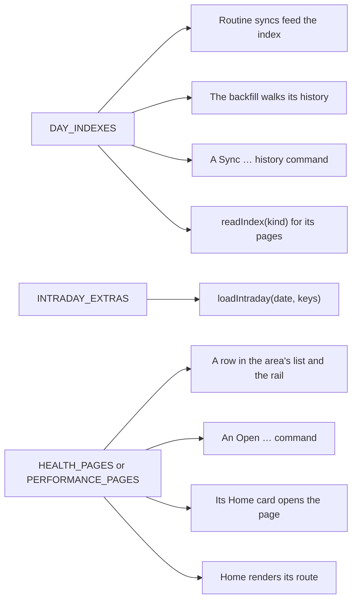

# Building pages

How the pages inside Home work and how to add one, for contributors and coding agents. The pages as
a user sees them are in the [Guide](GUIDE.md#home); the system around them is in
[Architecture](architecture.md).

**Code:** `src/dashboard/` (routes, registries, view models, chart geometry), `src/sync/*-index.ts`
and `src/sync/intraday-*.ts` (what the pages read), `src/ui/svelte/` (the components).

## What the pages read

A page never calls Garmin for its charts. It reads files the sync keeps, and asks for what a day or
an activity lacks only when it opens.

| Pages | Read | Kept current by |
| --- | --- | --- |
| Activities, All Activities, Cycling Power Curve | the activity index, `activities/` (`activity-index.ts`) | each sync's pages of the activity list (50 a page, up to five, back to the run's oldest day); the whole history once, from the backfill or **Sync activity history** |
| Steps, Floors, Intensity Minutes | the daily stats index, `daily-stats/` (`daily-stats.ts`) | each synced day's summary, at no cost; the range endpoints for days whose summary failed |
| Sleep | the sleep index, `sleep/` (`sleep-index.ts`), and the night in the day's series file | every sync with the `sleep` group on |
| Health and Performance Stats | mostly a day index each (see [Day indexes](#day-indexes)), and blocks loaded on view | routine syncs and the backfill |
| An activity's page | `activity-details/<id>.json` (`activity-detail.ts`) | `loadActivity` the first time it opens; the backfill's `details` task |
| Home | the day files, the series files, `account.json` and the indexes above | — |

The exceptions:
- Load reads Training Status's index, the day files and the activity index.
- Training Effect reads the activity index alone.
- Pulse Ox Acclimation reads Pulse Ox's index.
- Health Snapshot loads only on view.
- Lifestyle Logging reads nothing yet.

Every file and key is in the [Data reference](properties.md).

## Home's page stack

Home is one view, `garmin-home` (`GarminHomeView`, `src/dashboard/home-view.ts`), holding a stack
of pages (`src/dashboard/routes.ts`). Home sits at the bottom. Above it can be `glance` (See All),
`activities`, `category` (a sport), `month`, `records`, `all` (All Activities), `activity`,
`activity-map`, `stats` (Steps, Floors, Intensity Minutes), `sleep`, `sleep-factor`, `health`,
`health-stat`, `performance` or `performance-stat`.

- **Back** pops one page. A filter or a tab replaces the top page instead of adding a step.
- A link to a page already on the stack goes back down to it (`pushOrReturn`). Routes compare by
  `routeKey`, which sorts keys at every level.
- The stack is the view's state (`getState` / `setState`), so a reload returns to the same page.
  Every **Open …** command opens the view through the same `setState`.
- A route carries what its page shows. All Activities keeps its search, sort and filters
  (`AllRoute`); an activity keeps its tab, axis, expanded chart and picker choices (`picks`).
  `readRoute` repairs each field it reads back, and folds an old run route's `pace`, `heart` and
  `power` into `picks`.
- A saved route this version can't read is dropped from the stack. A stat route whose stat the
  registry knows but whose page isn't registered shows "This page isn't in this version of the
  plugin" instead. The old More page (`more`) is dropped this way.

### Areas and the navigation

`src/dashboard/areas.ts` names the **areas**: Home, Activities (`activities`), Health Stats
(`health`) and Performance Stats (`performance`). The last three's own pages, the area roots, sit
right above Home.

- **Where you get around.** `Home.svelte` measures the pane:
  - From 640 px the view shows `AreaRail` down its left side. It is expanded from 1000 px,
    collapsed to icons below, or as the user last left it (the view's `rail` state).
  - Under 640 px, Home and the area roots show `AreaTabs` inside `AreaHeader`.
  - Pages lay out in `.gch-main`, the page's column, and their `@container` rules measure that
    column, not the pane.
- **What each area holds.** `areaItems(area, built)` lists an area's pages, which both the rail and
  the area's own list (`ActivitiesHub`, `HealthHub`, `PerformanceHub`) show.
  - A registered hub stat joins its area there, with no other wiring.
  - `itemKey(route)` names the row a page belongs to.
  - `railFocus(stack)` picks the area to open and the row to light: the nearest listed page down
    from the top of the stack.
- **How pages open.**
  - The rail, the tabs and every **Open …** command open a page inside its area
    (`inArea(route)`: `[home, area, page]`).
  - `push` and `readStack` trim above the area root, never through it.
  - `getDisplayText` names the tab after the area.
- **Adding an area:** add it to `AREAS`, give its root a `Route`, and add its pages to `pageArea`,
  `areaItems` and `itemKey`. `tests/areas.test.ts` fails until every route kind has an area.

## Health and Performance Stats foundation

Every Health Stats page but Sleep, and every Performance Stats page, is built the same way:
- one registry, with one route and one hub per section;
- one way to keep a day index;
- one way to load a day's chart on view.

A stat is its own files plus three one-line registrations.

### What a stat owns

| File | What goes in it |
| --- | --- |
| `src/sync/<stat>-index.ts` | its day index (`defineDayIndex`). When its day page needs a payload the series file lacks, also its intraday extra (`defineIntraday`). No Obsidian import: the tests load every registered definition |
| `src/dashboard/<stat>-pages.ts`, `<stat>-charts.ts`, `<stat>-copy.ts` | the view model, the chart geometry and the wording Garmin keeps in its phrase tables. All pure, with golden-number tests |
| `src/ui/svelte/<stat>/` | the page, taking `HealthStatPageProps` or `PerformanceStatPageProps` |
| `tests/<stat>-*.test.ts` | its tests |

### The three registrations

```ts
// src/sync/day-indexes.ts
import { STRESS_INDEX } from "./stress-index";
export const DAY_INDEXES: readonly DayIndexDef[] = [STRESS_INDEX /* , … */];

// src/sync/intraday-extras.ts — only for a payload of the stat's own
import { STRESS_DAY } from "./stress-index";
export const INTRADAY_EXTRAS: readonly IntradayDef[] = [STRESS_DAY /* , … */];

// src/ui/svelte/health/pages.ts — or performance/pages.ts and PERFORMANCE_PAGES
import StressPage from "../stress/StressPage.svelte";
export const HEALTH_PAGES = { stress: StressPage /* , … */ };
```

Each registration switches on the rest without further edits:



| Registration | What it switches on |
| --- | --- |
| `DAY_INDEXES` | Routine syncs feed the index. The backfill walks its history once its consent key (`index:<kind>@<version>`) is agreed to and its group is on. It also adds a `Sync <title> history` command and `readIndex(kind)`, and Home watches its folder |
| `INTRADAY_EXTRAS` | `loadIntraday(date, [key])` fetches the payload for any day and keeps it in the series file under `extra[key]` |
| `HEALTH_PAGES` | the stat's row in the area's list and the rail, an `Open <stat>` command, its At a Glance card opening the page, and Home rendering it for the `health-stat` route |
| `PERFORMANCE_PAGES` | the same for the `performance-stat` route, and its In Focus card (Training Readiness, Training Status). A `hub: false` stat gets no row and no command. The Performance Stats area (its rail row and tab) and **Open performance stats** appear with the first hub stat |

### The registry

`HEALTH_STATS` (`src/dashboard/health-stats.ts`) and `PERFORMANCE_STATS`
(`src/dashboard/performance-stats.ts`) list every stat in the app's order as a `StatDef`
(`src/dashboard/stat-registry.ts`). A `StatDef` holds:
- its title, ranges (`PERIOD_RANGES`: 1d, 7d, 4w, 12w, 3m, 6m, 1y) and default range;
- its settings group, its `rangeLabels` ("Current" for 1d) and the At a Glance cards it claims.

A card is an id, or `{ id, tab?, sub?, range? }` when it lands on a tab (Cycling VO₂ Max on VO₂
Max's `cycling`). Performance also uses `tabs` (the first is the default), `spans` (below) and
`hub: false`, for a page only another page opens: Load and Heat Acclimation, from Training Status.
Stats reuse the settings' existing groups, so adding one needs no migration.

`statRegistry(list, { ownRoute, noPage })` reads a list as `HEALTH_REGISTRY` or
`PERFORMANCE_REGISTRY`, where `registered` is the page map's keys. It answers:
- `get(id)`, and `page(id)` on the section's route;
- `pageStats(registered)`, every registered page, hidden ones included;
- `hubStats(registered)` and `glanceTarget(card, registered)`.

Two stats are special. Health's Sleep is `ownRoute`: listed by the hub, on a route of its own.
Performance's Cycling Ability is `noPage`: neither routed nor listed. A card is claimed by one stat
at most, across both sections.

### Span rules

A range cuts its period by a `SpanRule` (`src/dashboard/periods.ts`). `spanOf(rule, offset,
today)` steps back one whole rule at a time. A stat lists only the rules that differ from its
ranges' defaults, in `spans`. `spanRuleOf(stat, range)` reads them, and `statSpan` and
`statPeriodLabel` (`stat-registry.ts`) give the period and its words.

| Rule | Period on Sunday 2026-10-11 |
| --- | --- |
| `{ days }`, the default: 7d 7, 4w 28, 12w 84, 6m 182, 1y 364 | 12w: Jul 20 – Oct 11 |
| `{ weeks, weekStart }`: this week so far and whole weeks before | Running Tolerance's Sunday 12w: Jul 26 – Oct 11 |
| `{ months }`: n months back plus a day; 3m's default | Cycling Power Curve's 3m: Jul 12 – Oct 11 |
| `{ months, calendar: true }`: calendar months | Hill Score's 1y: "Nov 2025 - Oct 2026" |
| `{ monthEnds }`: a point per month end, and today (`monthEndsOf`) | Race Predictor's 6m: May 31 – Oct 11 |

Health's stats name no rules, so `periodOf` (the defaults) covers them.

### The route

A Health Stats route has the shape `{ page: "health-stat", stat, range, offset, tab?, sub?, date? }`
and is opened with `healthStatRoute(stat, opts?)`. The Performance route is `performance-stat`,
opened with `performanceStatRoute`, and `{ page: "performance" }` is that section's hub.

When a route is read back from saved state:
- an unknown stat is refused. So are Sleep, which keeps its own route, and Cycling Ability, which
  has none;
- a range the stat lacks becomes its default;
- an `offset` that isn't a whole number at or below 0 becomes 0;
- `tab` and `sub` are kept when they are short tokens, and `date` when it is `YYYY-MM-DD`.

What `tab`, `sub` and `date` mean is the page's business: Health Status keeps its open metric sheet
in `sub`.

`moveStatRoute(route, period)` moves a page in place, keeping its tab and sub-page. `statOfRoute`
finds a route's stat in its section's registry. `performanceTargetRoute(target, dayOffset)` is
the page a Performance card opens, on Home's day when it opens on 1d.

## Day indexes

A day index is one short row a day for a stat's whole history:
- a year file per year, `<dataFolder>/<folder>/<year>.json`, holding
  `{version, year, <listKey>: [...]}`, one row a line, oldest first;
- `index.json`, holding `{version, from?, to?, complete}`.

A file is written only when its text changes. The real Stress index
(`src/sync/stress-index.ts`):

```ts
export const STRESS_INDEX = defineDayIndex<StressRow>({
	kind: "stress",
	title: "stress",
	folder: "stress",
	version: 1,
	columns: { level: {}, rest: {}, low: {}, medium: {}, high: {}, qualifier: { text: true } },
	keepOld: true,
	group: "stress",
	windowDays: 28,
	emptyWindowsToStop: 2,
	fetchWindow: async (api, start, end) => (await api.stressDaily(start, end)).map(rowOfStat),
	fromSummary: (summary) => rowOfSummary(summary),
});
```

| Field | Meaning |
| --- | --- |
| `kind`, `title`, `folder` | The id (`readIndex(kind)`, the history command, the progress map), how it reads mid-sentence ("Sync stress history"), and its folder. `kind` and `folder` are lowercase and hyphenated |
| `version` | Bump when a row's meaning changes. An `index.json` of another version reads as none, and the history is fetched again once its new consent key is agreed to. See [Data versions](CONTRIBUTING.md#data-versions) |
| `listKey` | The list's key in a year file: `days` unless the stat reads better otherwise |
| `columns` | The row's keys, in order. A number is rounded to `precision` decimals (whole by default). A negative is Garmin's "not measured" and is dropped, unless `signed`. `text` keeps a trimmed word. Unknown keys, nulls and empty rows are dropped |
| `keepOld` | `true` keeps the fields a new row lacks; `false` replaces the row whole. A day a fetch found empty loses its row either way |
| `group` | The settings group. Nothing is fetched while it is off |
| `windowDays` | Days one window request covers: `DEFAULT_WINDOW_DAYS` (28) unless the route takes more, up to `MAX_WINDOW_DAYS` (3660) |
| `refreshDays` | Days back from a routine sync's last day that are fetched again on every sync, for a stat Garmin revises late. 0 by default |
| `emptyWindowsToStop`, `maxHistoryDays` | When a history walk stops: after that many windows in a row without a row (once past the oldest activity), or at how far back Garmin keeps the stat |
| `requestsPerWindow` | What one window costs when `fetchWindow` asks more than one route: FTP and lactate threshold take 2. It is booked in sync reports, walk logs and estimates |
| `fetchWindow(api, start, end)` | One window's rows. The definition owns its requests |
| `fromSummary(summary, date)` | The run's own days, taken from the daily summary the sync fetches anyway, at no cost |
| `fromDay` | A `DayFeed` (`needs`, `read(day, date)`): the run's own days, taken from what the day sync fetched for the day file (`maxMetrics`, `hillScore`, `runningTolerance` and so on). Not allowed with `fromSummary`. A day counts as covered only when every part in `needs` came back |

> [!WARNING]
> Body Battery and Weight each ask two routes per window but leave `requestsPerWindow` at 1, so
> sync reports and estimates undercount them. The hourly budget is unaffected: it counts real
> requests.

`defineDayIndex` throws on a definition that cannot work, so the mistake fails the tests rather
than a sync. It checks:
- the names, and that `kind` and `folder` aren't in `RESERVED_INDEX_NAMES`;
- the columns;
- a window outside 1–3660, or a refresh outside 0–3660;
- a non-positive `emptyWindowsToStop`;
- `fromDay` beside `fromSummary`, or a `fromDay` that needs nothing.

`tests/day-index.test.ts` catches two indexes sharing a folder. `RESERVED_INDEX_NAMES` doesn't list
`days`, the day files' folder.

How an index fills:
- `takeSummary` and `takeDay` (`src/sync/engine.ts`) take the run's own days at no cost.
- `feedIndex` asks `fetchWindow` for the days they missed, the stretch since `index.json`'s `to`,
  and the `refreshDays`. An index with neither `fromSummary` nor `fromDay` therefore asks a window
  on every routine sync.
- `walkHistory` goes back a window at a time, a year of windows per backfill segment.
- `VaultSeriesStore.mergeDayIndex` merges each batch. Home re-reads an index only when
  `versions[kind]` moves.

Each index's folder, columns, window and refresh are listed in the
[Data reference](properties.md#history-indexes).

## Loading on view

### Intraday on view

A routine sync spends intraday requests only on the days inside Day details. **Sync a date range…**
spends them on every day it covers. A day page asks for what it draws instead:
`loadIntraday(date, keys)` fetches whatever of `keys` the day's series file lacks, merges it in,
writes the file and resolves with the day's series.

- **The series file's own blocks** load under the `intraday` group: `stress` and `bodyBattery` (one
  request), `heartRate` and `bodyBatteryEvents`. So a Stress, Body Battery or Heart Rate day page
  reads an old day the same way it reads today. Steps, floors and intensity minutes aren't
  loadable; their pages read what a sync wrote.
- **An extra** goes under `extra[key]` and is gated on its own group. The keys are `stressDay`,
  `heartDay`, `respirationDay`, `fitnessAgeDay`, `snapshotList`, `snapshotDay`, `spo2Day`,
  `hrvDay`, `enduranceDay` and `readinessDay`. `checked` lists the keys fetched on view, with data or
  without, so a day Garmin had nothing for isn't asked again.
- **An extra with `fromDay`** is written by the sync itself, for every synced day whose payload the
  day sync fetched anyway: `hrvDay` from `hrv`, `readinessDay` from `readiness`. An empty or failed
  fetch never erases one an earlier sync kept, because Garmin drops old HRV readings.
- **Loads run in the runner as page work,** never beside a sync.
  - They wait for a running sync, and a second ask for a day already waiting joins it.
  - The client's throttle paces them, and they go ahead of the backfill.
  - Signed out, or with the block's group off, a load resolves at once and its `reason` says why.
  - A 429 answers every waiting load without asking again.
- **A sync's write of a day** (`keepBlocks`, `src/sync/intraday-registry.ts`) refreshes the blocks
  it asked Garmin for, and keeps the file's copy of any block Garmin no longer sends.
  - A write that fetched the day's intraday drops the on-view extras and `checked`, so the next
    view fetches them fresh. The sync's own extras (`hrvDay`, `readinessDay`) stay.
  - A write that fetched only the night changes the night's blocks and keeps the rest.

A day page reads its series. While `missingKeys(series, keys)` isn't empty, it shows the day's
summary from its index as `loadIntraday` runs.

### Activity details on view

An activity's page is never synced. `loadActivity(id)` fetches it the first time the page opens, and
keeps it in `<dataFolder>/activity-details/<id>.json` (`src/sync/activity-detail.ts`), outside
`activities/` so the write doesn't rebuild Home.

- **Seven blocks go together,** one request each: the summary, the samples (`details`, kept as
  named columns plus `clock`), the laps, the typed splits, heart-rate zones, gear and badges.
- **Then the blocks the summary says apply** (`AFTER_SUMMARY`):
  - power zones, when it has time in them;
  - weather, with a GPS track;
  - the device as it was;
  - the weight on the activity's day, with power, for W/kg.

  A block that doesn't apply is marked checked without a request. That makes 11 requests for a run
  or ride with power, 9 for one without power or an open-water swim, and 8 without GPS or power,
  such as a pool swim or yoga.
- **Sensors** are named from the summary's FIT product numbers (`src/garmin/device-names.ts`),
  never with a request, and no serial number is kept.
- **`checked`** lists the blocks fetched, with data or without. A block whose request failed is
  asked again on the next view; one Garmin had nothing for isn't.
- **A file is fetched afresh** when the index shows its activity renamed or trimmed. A file of
  another `version` reads as missing, with one exception: a running file of version 5 reads as 6,
  with the blocks version 6 changed (`CHANGED_IN_6`: the summary and the badges) left to fetch.
- **The loads queue with the intraday ones,** in the same runner and gated on the `workouts` group.
  With **Activity details** past `opened`, the backfill's `details` task loads the rest the same
  way: newest first, one a unit, at least two seconds apart.
- **The view keeps the last few details in memory,** so a page coming back (Back from the map)
  draws at once and holds its scroll position.

The map draws the route from the `lat` and `lon` columns, so the route itself needs nothing from the
network. Its tiles come from OpenStreetMap through `src/ui/map/`: `requestUrl`, a User-Agent that
names the plugin, and an IndexedDB cache. With **Map tiles** off, offline, or refused, the route
draws on its own.

## What a page gets

`StatPageProps<R>` (`src/ui/svelte/health/pages.ts`) is the one object Home hands both sections'
pages. `HealthStatPageProps` and `PerformanceStatPageProps` are the same object on their routes.

| Prop | What it is |
| --- | --- |
| `route`, `today`, `units`, `canSync` | the page's route; today's date; the account's units; whether a sync can run |
| `onBack`, `go`, `swap` | pop the page; push a route; replace the top route |
| `readSeries(days)`, `readIndex(kind)`, `readDays()`, `readAccount()` | the series files; a day index; every day file's row; `account.json` |
| `loadIntraday(date, keys)`, `onSyncHistory(kind)` | load blocks on view; start a history walk |
| `versions`, `seriesVersion` | re-read an index when `versions[kind]` moves, the day files on `versions["#days"]`, the account on `versions["#account"]`, and the series on `seriesVersion` |
| `history` | walks in progress, by kind |
| `openSheet` | one of Garmin's bottom sheets |
| `activities` | the activity index, as the Activities pages get it |

The history banner (`src/ui/svelte/activities/HistoryBanner.svelte`) shows while `history[kind]` is
set or the index's meta isn't `complete`.

## Building a stat page

A stat page is the shared parts below plus the stat's own view model, chart frames and marks. Start
from a finished stat: Stress (`src/ui/svelte/stress/`) or Respiration
(`src/ui/svelte/respiration/`). Import its building blocks rather than copying them.

| Shared part | What it gives a stat |
| --- | --- |
| `src/dashboard/periods.ts` | `spanOf` and the span rules; `periodOf` (a range's default span); `rollingWeeks`, `weeksOf`; `switchRange`, `stepRoute`, `dayCardRoute`, `weekCardRoute`; the labels (`dayLabel`, `periodLabel`, `yearLabel`, `weekTitle`, `cardDate`); the axes (`dayAxis`, `monthAxis`); `meanOf(values, rounding)` and `mean`; the date words (`longDate`, `weekdayOf`, `daysBetween`, `shiftMonth`, `lastDayOfMonth`, `MONTHS`, `WEEKDAYS`, `SHORT_MONTHS`) |
| `src/dashboard/stat-charts.ts` | `ChartFrame` (a chart's insets and heights, measured off the stat's Figma twin, for the phone and for a pane), `plotBox(frame, width, ticks, axis)` (gridlines, y labels, the axis and the scale), `linePath` (a line that breaks at a missing value) |
| `src/dashboard/stat-dial.ts`, `stat-controls.ts` | the Performance Stats dial, and the state of its chips |
| `health/StatPageShell.svelte` | the sticky header (back, title, the range control from the registry, the period stepper), the history banner, and the phone and pane containers (640 and 1000 pt) |
| `health/StatChart.svelte` | a chart under its title, with `under` and `over` snippets for the marks and a `footer` for its key |
| `health/StatFigures.svelte` | figures two to a row under a rule |
| `health/StatCardList.svelte`, `StatCard.svelte` | a period's day or week cards, with an optional `visual` snippet; one a row, two from 640 pt, three in a pane |
| `health/StatDayLayout.svelte`, `StatPeriodLayout.svelte` | a 1d body (summary, then chart) and a 7d / 4w / 1y body (chart, figures, list), side by side in a pane |

`StatPageShell` takes the page's `route`, `today`, `onBack` and `swap`, plus `label` and
`canGoBack` from the stat's view. Its optional props:
- `history` (`{ title, windowDays, complete, walking, canSync, onSync }`) drives the banner;
- `style` sets custom properties, such as the stat's colours;
- `ranges` and `rangeLabels` override the registry's;
- `steppers={false}` shows the label alone;
- `step` and `canGoForward` replace the default stepping;
- `title`, `navTitle` and `top` override the header's title and add content above the body.

Its body snippet gets `{ pane, move, span }`, so a card moves the page with
`move(dayCardRoute(date, today))`. Spacing follows the Stress twin unless a stat sets these custom
properties:
- the layouts': `--stat-chart-top`, `--stat-chart-top-pane`, `--stat-figures-top-pane`;
- the card list's (`StatCardList.svelte`): `--stat-list-top`, `--stat-list-top-pane`.

A 7d / 4w page in outline, simplified from Respiration's:

```ts
// src/dashboard/respiration-charts.ts — the frames are measured off the stat's Obsidian twin
export function averagesPlot(view: RespirationPeriodView, width: number, pane: boolean): AveragesPlot {
	const f = respirationFrame(view.range === "4w" ? "month" : "week", pane);
	const { box, scale } = plotBox(f, width, view.ticks, view.axis);
	const series = (key: "sleep" | "awake") =>
		view.points.map((p): [number, number | null] => [scale.x(p.x), p[key] === null ? null : scale.y(p[key]!)]);
	return { ...box, sleep: linePath(series("sleep")), awake: linePath(series("awake")), points: [] /* the dots */ };
}
```

```svelte
<!-- src/ui/svelte/respiration/RespirationPage.svelte, the 7d / 4w body (simplified) -->
<StatPageShell {route} {today} {onBack} {swap} label={periodView.label} canGoBack={periodView.canGoBack}
	history={{ title: RESPIRATION_INDEX.title, windowDays: RESPIRATION_INDEX.windowDays,
		complete: meta?.complete ?? false, walking: history[KIND], canSync, onSync: () => onSyncHistory(KIND) }}>
	{#snippet children({ pane, move })}
		<StatPeriodLayout>
			{#snippet chart()}<RespirationAverages view={periodView} {pane} />{/snippet}
			{#snippet figures()}<StatFigures figures={periodView.stats.map(figure)} />{/snippet}
			{#snippet list()}
				<StatCardList items={cards.map((c) => ({ ...c, onclick: () => move(dayCardRoute(c.key, today)) }))} />
			{/snippet}
		</StatPeriodLayout>
	{/snippet}
</StatPageShell>
```

`RespirationAverages.svelte` wraps `StatChart` with
`plot={(width) => averagesPlot(view, width, pane)}` and draws the two lines in its `over` snippet.
The view behind it, `respirationPeriodView` (`src/dashboard/respiration-pages.ts`), builds on these
helpers:
- `periodOf` for the span;
- `daysOf` and `dayAxis` for the points and the axis;
- `periodLabel` for the label;
- `meanOf(values, "round")` for the averages.

Each stat keeps its own:
- view-model rules: what a figure is, its rounding, its copy;
- chart frames, measured off its own twin, and marks;
- anything only it draws.

## Activity pages

Every activity opens the same page (`src/ui/svelte/activity/ActivityPage.svelte`) with the run's
five tabs: Overview, Stats, Laps, Charts and Gear. What fills them depends on the sport.

### Sport profiles

`sportOf` (`src/dashboard/activity-sports.ts`) reads an activity's place in Garmin's type tree,
as the hub's categories do (`categoryOf`):
- the running family is `running`, and the cycling family is `cycling`;
- `lap_swimming` is `pool-swim`, and `open_water_swimming` is `open-water-swim`;
- every other sport is `basic`.

`profileFor` hands the page that sport's `SportProfile`, from `src/dashboard/sports/`:

| Profile | File | Draws |
| --- | --- | --- |
| `RUNNING` | `running.ts` | every run: outdoor, trail, track or treadmill |
| `CYCLING` | `cycling.ts` | every cycling type: the power-zone map, Power and Cycling Dynamics, and the ride's own chart cards (`cycling-metrics.ts`, placed by `cycling-activity-charts.ts`) |
| `POOL_SWIM`, `OPEN_WATER_SWIM` | `swimming.ts` | the pool's intervals and a bar a length (`swim-metrics.ts`); open water's red route |
| `BASIC` | `basic.ts` | every other sport, modelled on Garmin's Stair Stepper: the sections the sports share, each only with data |

A profile has five optional parts, and each tab's shared view model takes its part as an argument:

| Part | Says | Read by |
| --- | --- | --- |
| `overview` (`OverviewSpec`) | the big figure, the figures under it, the Navigation links | `overviewView` |
| `stats` (`StatsSpec`) | the sections in order, and which have a HELP link | `statsView` |
| `laps` (`LapsSpec`) | the columns and the rows, a rest or a Total among them | `lapsView` |
| `charts` (`ChartsSpec`) | the cards, chips, pickers, the charts the run lacks, the zones' names and colours | `chartsTabView`, `expandedChartView` |
| `map` (`MapSpec`) | the map's overlays, their colours and legend words, the plain route's colour | `activity-map.ts` |

- **A part left out is the run's.** The view models' defaults are the run page, so `RUNNING` is only
  `{ id: "running" }`. `tests/run-page-baseline.test.ts` pins every view the run page draws, for an
  outdoor and a treadmill run in both units, so nothing another sport needs can move the run.
- **The sport modules import the shared view models,** never the other way round.
  `activity-chart-pages.ts` reads only their data-only palettes (`sports/*-palette.ts`).
- **What a sport draws beyond the run comes through `ChartsSpec`,** every hook opt-in:
  - `metrics`: a ride's speed, power phases and pedal offsets;
  - `custom`: cards the sport draws itself;
  - `runOverrides`: one of the run's charts drawn its own way;
  - `zoneTotal`, `places` and `distanceAxis`: samples that carry no distance, such as a pool
    swim's lengths.
- **A custom card names its plot** (`CustomChart.plot`). Each sport keeps its plots in its own
  folder (`activity/cycling/plots.ts`), which `activity/charts/kinds.ts` spreads into `CARD_PLOTS`.
- **A map overlay can bin by the activity's own zones** (`MapOverlayDef.zones`): a ride's route
  takes a colour per power zone.

### The type table

`src/dashboard/activity-types.ts` lists Garmin's activity types. Each has the app's English name,
the filter group All Activities files it under, its place in that group and its card's disc colour.
It is edited by hand. The daily contract check watches only the shape of Garmin's `activity-types`
answer, not its contents, so a type Garmin adds shows up only as one the table lacks.

- `FILTER_GROUPS` holds the Filters sheet's groups in its order, with the first `SHOWN_GROUPS`
  before **Show All**.
- `typeName` names a type wherever a page does. `groupOf`, `groupName`, `subTypes` and `discOf` read
  the rest.
- A type the table lacks, one Garmin adds later, is named from its key and filed under its parent's
  group, else Other.
- The "All … Activities" link under an activity (`groupLink` in `activity-overview.ts`) opens the
  hub's page for its group where there is one (`hubOfGroup`), else All Activities filtered to the
  group.

### All Activities

`src/dashboard/all-activities.ts` searches, sorts and filters the activity index, so the page sends
no request. The route (`AllRoute`) holds all of it, in metres and seconds whatever the units:
- the search `q` and the `sort`;
- the Filters sheet's `types`, `from`/`to`, `dmin`/`dmax`, `tmin`/`tmax`, `amin`/`amax`,
  `events`, `fav` and `pr`.

Each field is checked and repaired on its own (`allOf`), so one bad value never costs the others.

- **`allView(rows, route, units, today)`** returns the matching rows as cards in the route's order,
  the exact count, a chip per filter (whose `remove` is the same route without it), and the empty
  state.
- **`matcherOf`** treats the search as a substring of the card's folded name (`fold`: accents
  dropped, lower case).
  - Types are OR'd, by a row's own type or its group.
  - A distance, time or ascent a row lacks counts as 0.
- **Sorting:** Newest First goes by the local start, then the GMT start, then the id, which is
  Garmin's own order. A to Z and Z to A compare folded names, ties newest first.
- **The Filters sheet edits a draft** (`draftOf`, `toggleType`, `setDates`, `setRange` …),
  counted live by `footerOf`. `applyDraft` makes the route and keeps the search and the sort.
- **The page draws sixty cards,** and adds sixty more as the list scrolls.

## Charts and settings UI

The UI is **Svelte 5**, set up as [Obsidian's guide][svelte-guide] prescribes: `esbuild-svelte` in
the build, with components mounted with `mount()` and torn down with `unmount()`.

- **Charts are hand-drawn SVG,** with no chart library. A plugin can't load external scripts, and a
  bundled library would be dead weight on a phone.
  - A chart is markup. Its geometry lives in a pure `*-charts.ts` beside the view model, so it is
    unit-tested without a DOM.
  - The one exception is Leaflet, for the activity map (`src/ui/map/leaflet.ts`): panning and
    pinching a tiled map on a phone is where hand-rolled code breaks. It is bundled, evaluated only
    when the first map draws, and leaves `window.L` to whichever plugin owns it. Its stylesheet is
    copied to the top of `styles.css`, less the old-browser fallbacks and `!important` the
    Community directory's review flags; `tests/leaflet-styles.test.ts` lists each edit and fails if
    the copy drifts from the installed Leaflet.
- **Settings are declared, not drawn.** `GarminSettingTab.getSettingDefinitions()` (`src/settings.ts`)
  lists every row, so Obsidian draws them natively and its settings search finds them. Plain values
  are `control` rows bound through `getControlValue`/`setControlValue`; rows with side effects or
  live text use `render`, and the Data rows share `SettingsDataRows` (`src/ui/settings-data-rows.ts`),
  which listens to the sync only while one of them is on screen. The download block is the one Svelte
  component in the tab (`settings/DataStatus.svelte`).
- **Obsidian comes into the components through actions** (`home/lucide.ts`,
  `activity/map/toggle.ts`). A few components import it directly: `ChartsTab.svelte` for `Platform`,
  and the menus (the sub-type picker, All Activities' Sort, the Charts pickers).
- **Avoid Obsidian's global class names** (`.card`, `.prompt`, `.message`, `.notice`, `.menu`):
  Obsidian styles them. Pages use container queries at 640 and 1000.

[svelte-guide]: https://docs.obsidian.md/Plugins/Getting+started/Use+Svelte+in+your+plugin
