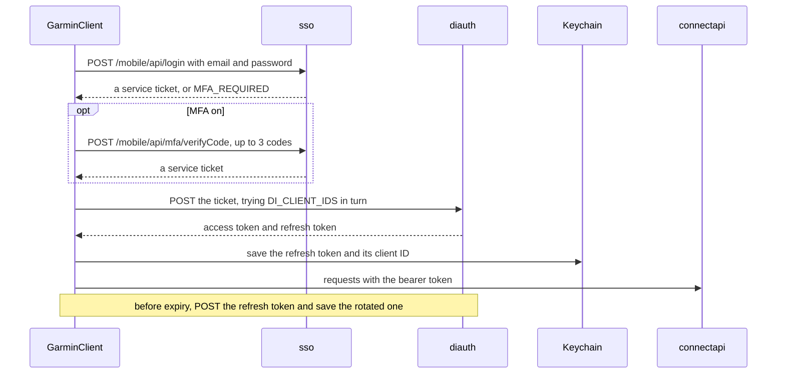

# Garmin API reference

Every Garmin endpoint the plugin calls, when it calls it and what it costs. The full catalogue is
[`api/endpoints.json`](../api/endpoints.json), described in [`api/README.md`](../api/README.md). It
holds every route upstream knows plus the plugin's own additions, with their request shapes; the
recorded response shapes are in [`api/schema/`](../api/schema/).

**Code:** `src/garmin/endpoints.ts` (the wrappers), `src/garmin/constants.ts` (hosts, client IDs,
headers), `src/garmin/auth.ts` (sign-in), `src/garmin/client.ts` (the transport).

The sign-in mirrors [`cyberjunky/python-garminconnect`](https://github.com/cyberjunky/python-garminconnect)
at master: the rewrite that dropped `garth`, with no OAuth1 and no request signing, which is why it
ports to TypeScript cleanly.

## Hosts

Derived from the `domain` setting: `garmin.com`, or `garmin.cn` for China.

| Name | Host | Role |
| --- | --- | --- |
| `sso` | `sso.{domain}` | sign-in and MFA |
| `diToken` | `diauth.{domain}/di-oauth2-service/oauth/token` | service ticket → bearer tokens; token refresh |
| `connectApi` | `connectapi.{domain}` | everything below |
| `iosService` | `mobile.integration.{domain}/gcm/ios` | the service URL the ticket is bound to; a parameter, never requested |

## Authentication

A real sign-in is steps 1–3 below (step 2 only with MFA), then the session is saved to this
device's keychain. A refresh uses the refresh token and saves the token Garmin hands back, which
may be a new one.



| Step | Request |
| --- | --- |
| 0 | `GET {sso}/mobile/api/login`: a credential-free reachability check. The route takes only POST, so a JSON `405` means the edge let you through; a `403` means it didn't. **Diagnostics only.** |
| 1 | `POST {sso}/mobile/api/login`: a JSON body, iOS client. Returns a service ticket. |
| 2 | `POST {sso}/mobile/api/mfa/verifyCode`, when step 1 answers `MFA_REQUIRED`. It carries the cookies step 1 set: the two POSTs share one `CookieJar`, because `requestUrl` keeps none. Up to `MFA_MAX_ATTEMPTS` (3) codes a sign-in. |
| 3 | `POST {diToken}`: exchanges the ticket for OAuth2 bearer tokens, with HTTP Basic and an empty password. |
| 4 | Any `connectapi` call, to confirm the API accepts the token. **Diagnostics only.** |

The service URL at step 3 **must match** the one used at login, or DI rejects the ticket.

### Client IDs

`DI_CLIENT_IDS` is tried in order, and the first that returns 200 wins. **Garmin rotates these
roughly quarterly**, so a step-3 failure after a successful step 1 usually means the list is stale.
Check it against `python-garminconnect` master.

```text
GARMIN_CONNECT_MOBILE_ANDROID_DI_2025Q2
GARMIN_CONNECT_MOBILE_ANDROID_DI_2024Q4
GARMIN_CONNECT_MOBILE_ANDROID_DI
GARMIN_CONNECT_MOBILE_IOS_DI
```

### Headers

Authenticated calls carry the Android app's header set (`nativeHeaders()`): `User-Agent:
GCM-Android-5.23`, `X-Garmin-User-Agent`, `X-Garmin-Paired-App-Version`,
`X-Garmin-Client-Platform`, `X-App-Ver`, `X-Lang`, `X-GCExperience`, `Accept-Language`. Sign-in uses
an iOS User-Agent instead (`IOS_LOGIN_UA`), with the `GCM_IOS_DARK` SSO client.

## Profile

| Method | Path | Notes |
| --- | --- | --- |
| `socialProfile()` | `/userprofile-service/socialProfile` | Caches `displayName`, which most wellness paths interpolate. |
| `userSettings()` | `/userprofile-service/userprofile/user-settings` | The account's units for the `auto` setting, its sex for `profile`, and the height Weight's BMI needs. |

`requireDisplayName()` **URL-encodes** the display name before putting it in a path, so a hostile or
corrupted profile can't inject path segments.

## Per-day endpoints

One request per day synced, for each group that is on.

| Method | Path | Group |
| --- | --- | --- |
| `dailySummary(date)` | `/usersummary-service/usersummary/daily/{who}?calendarDate=` | `activity`, `heart`, `stress`, `respiration`, `spo2` |
| `sleep(date)` | `/wellness-service/wellness/dailySleepData/{who}` | `sleep` |
| `hrv(date)` | `/hrv-service/hrv/{date}` | `hrv` |
| `trainingReadiness(date)` | `/metrics-service/metrics/trainingreadiness/{date}` | `readiness` |
| `enduranceScore(date)` | `/metrics-service/metrics/endurancescore?calendarDate=` | `fitness` |
| `fitnessAge(date)` | `/fitnessage-service/fitnessage/{date}` | `fitness` |
| `trainingStatus(date)` | `/metrics-service/metrics/trainingstatus/aggregated/{date}` | `training` |
| `bodyComposition(date)` | `/weight-service/weight/dayview/{date}?includeAll=true` | `body` |
| `healthStatus(date)` | `POST /graphql-gateway/graphql`, `healthStatusSummary` | `health` |

- **`dailySummary` serves five groups from one request,** so switching off only some of them saves
  nothing. Respiration and Pulse Ox cost no requests of their own.
- **`dailySummary` throws `GarminApiError` (status 403) for a `privacyProtected: true` answer.**
  Read as empty, it would pass for a day without data. The summary is dropped with a warning, the
  rest of the day is still written (and not booked as whole), and the session is fine: signing in
  again gets the same answer.
- **`enduranceScore` stays per day:** only the day route sends the day's class and feedback phrase.

### GraphQL

`graphql(query)` posts to `/graphql-gateway/graphql`, the web app's gateway, with the same bearer
token. The sync uses it for Health Status, Health Snapshots, hill score, cycling ability and the My
Day event list, with the queries inline as the web app sends them. Health Status and Health
Snapshots also have REST routes, which the [Health Stats pages](#health-stats-pages) use.

### More range calls

| Method | Path | Group | Window |
| --- | --- | --- | --- |
| `hillScores(start, end)` | GraphQL `hillScoreScalar` (a proxy of `/metrics-service/metrics/hillscore/stats`) | `fitness` | 365 days (Garmin's cap is 401) |
| `runningTolerance(start, end)` | `/metrics-service/metrics/runningtolerance/stats?aggregation=daily` | `training` | 365 days (Garmin's cap is 366) |
| `healthSnapshots(start, end)` | GraphQL `healthSnapshotScalar` | `health` | 28 days (`SHORT_RANGE_DAYS`); the route's cap is unpublished |

The web app asks for one week of snapshots at a time. The comment above `SHORT_RANGE_DAYS`
(`src/sync/engine.ts`) still says the window stays within that week, but the code asks four times
as much.

### Once per sync (`profile`)

Written to `account.json`, about nine requests a sync. A tenth (`socialProfile`) is made when the
display name isn't cached yet this session.

| Method | Path |
| --- | --- |
| `lastUsedDevice()` | `/device-service/deviceservice/mylastused` |
| `userSettings()` | `/userprofile-service/userprofile/user-settings` |
| `lactateThreshold()` | `/biometric-service/biometric/latestLactateThreshold` |
| `powerToWeight(date)` | `/biometric-service/biometric/powerToWeight/latest/{date}`: one call, no sport filter, a row per sport |
| `runningEconomy(date)` | `/metrics-service/metrics/runningeconomy/latest/{date}` |
| `trainingPlans()` | `/trainingplan-service/trainingplan/plans?limit=50` |
| `personalRecords()` | `/personalrecord-service/personalrecord/prs/{who}?includeHistory=false` |
| `cyclingAbility(date)` | GraphQL `cyclingAbility` |
| `upcomingEvents(date)` | GraphQL `myDayCardEventsScalar` |

**Sync recent days** also calls `lastUsedDevice()` once before the days, for the watch's last upload,
which is the sync's mark. See [properties → profile](properties.md#profile--accountjson) for what
lands in `account.json`.

### Intraday (the days inside Day details)

Six requests a day, for the `intraday` group:

| Method | Path | Fills |
| --- | --- | --- |
| `stress(date)` | `/wellness-service/wellness/dailyStress/{date}` | stress and Body Battery |
| `heartRate(date)` | `/wellness-service/wellness/dailyHeartRate/{who}?date=` | heart rate |
| `stepsChart(date)` | `/wellness-service/wellness/dailySummaryChart/{who}?date=` | steps |
| `floorsChart(date)` | `/wellness-service/wellness/floorsChartData/daily/{date}` | floors, in 15-minute buckets |
| `intensityMinutesChart(date)` | `/wellness-service/wellness/daily/im/{date}` | intensity minutes, in 15-minute buckets |
| `bodyBatteryEvents(date)` | `/wellness-service/wellness/bodyBattery/events/{date}` | Body Battery events |

These go to `<dataFolder>/series/<date>.json`, not the day files (see
[properties → intraday](properties.md#intraday)). Which days ask them:
- **After the setup:** a sync, for each of its days inside the Day details range, and the history
  download for each day it fetches.
- **Before the setup:** a sync, for its newest seven days (`INTRADAY_DAYS`, `src/sync/engine.ts`).
- **Sync a date range…:** every day it covers.

## Range endpoints

Called once for the whole run, in windows of up to a year (`RANGE_CHUNK_DAYS`).

| Method | Path | Group |
| --- | --- | --- |
| `maxMetrics(start, end)` | `/metrics-service/metrics/maxmet/daily/{start}/{end}` | `fitness` |
| `racePredictions(start, end)` | `/metrics-service/metrics/racepredictions/daily/{who}?fromCalendarDate=&toCalendarDate=` | `races` |
| `activities(start, limit)` | `/activitylist-service/activities/search/activities?start=&limit=` | `workouts` |
| `activitiesByDate(from, to, start, limit)` | `/activitylist-service/activities/search/activities?startDate=&endDate=&start=&limit=` | `workouts` |

- **`racePredictions` rejects ranges longer than a year,** so a long run is cut into years.
- **`activities` is paged rather than dated.** A sync pages back through it 50 at a time, five pages
  at most, to the run's oldest day. It files each activity under the local day it started on.
- **A history-download chunk** lists its days' activities with `activitiesByDate` instead, a request
  per hundred, since paging from today would never reach a chunk far back. That list feeds the day files only, not the
  activity index.

## History index endpoints

The pages inside Home read history indexes the sync keeps beside the day files (see
[properties → history indexes](properties.md#history-indexes)). These routes fill the indexes that
aren't Health Stats pages'. VO₂ Max, Hill Score, Race Predictor and daily Running Tolerance walk
their history with the range calls above:

| Method | Path | Index | Per request |
| --- | --- | --- | --- |
| `dailyStepStats(start, end)` | `/usersummary-service/stats/steps/daily/{start}/{end}` | `daily-stats/` | 28 days |
| `dailyFloorStats(start, end)` | `/usersummary-service/stats/floors/daily/{start}/{end}` | `daily-stats/` | 28 days |
| `dailyIntensityStats(start, end)` | `/usersummary-service/stats/im/daily/{start}/{end}` | `daily-stats/` | 28 days |
| `sleepStats(start, end)` | `/sleep-service/stats/sleep/daily/{start}/{end}` | `sleep/` | 28 nights |
| `activityCount()` | `/activitylist-service/activities/count` | `activities/` | how long the list is |
| `activities(start, limit)` | as above | `activities/` | 100 activities |
| `hrvDaily(start, end)` | `/hrv-service/hrv/daily/{start}/{end}` | `hrv-status/` | 367 days, Garmin's cap |
| `trainingStatusWeekly(start, end)` | `/metrics-service/metrics/trainingstatus/weekly/{who}`: a row a day, despite the name | `training-status/` | 365 days (no cap found) |
| `enduranceStats(start, end, "daily")` | `/metrics-service/metrics/endurancescore/stats?aggregation=daily` | `endurance-score/` | 365 days (Garmin's cap is 401) |
| `runningTolerance(start, end, "weekly")` | `/metrics-service/metrics/runningtolerance/stats?aggregation=weekly`: Sunday weeks, to date | `running-tolerance-weeks/` | 350 days, widened to whole weeks (cap 366) |
| `trainingReadinessRange(start, end)` | `/metrics-service/metrics/trainingreadiness/{start}/{end}`: every reading, newest first | `training-readiness/` | 367 days, Garmin's cap |
| `functionalThresholdPowerRange(start, end)`, `powerToWeightRange(start, end)` | `/biometric-service/stats/functionalThresholdPower/range/{start}/{end}`, `/biometric-service/stats/powerToWeight/range/{start}/{end}?aggregation=daily`: change points, every sport | `ftp/` | 367 days (end − start ≤ 366); two requests a window |
| `lactateThresholdHeartRateRange(start, end)`, `lactateThresholdSpeedRange(start, end)` | `/biometric-service/stats/lactateThresholdHeartRate/range/{start}/{end}`, `…/lactateThresholdSpeed/range/{start}/{end}`: change points, sport `RUNNING` | `lactate-threshold/` | 367 days (end − start ≤ 366); two requests a window |
| `runningEconomyDaily(start, end)` | `/metrics-service/metrics/runningeconomy/daily?startDate=&endDate=` | `running-economy/` | 366 days (one calendar year) |
| `criticalSwimSpeedRange(start, end)` | `/biometric-service/criticalSwimSpeed/range/{start}/{end}` | `critical-swim-speed/` | 367 days (end − start ≤ 366) |
| `hrvStressDaily(start, end)` | `/metrics-service/internal/manualstresslevel/daily/{pk}/{start}/{end}`: the manual HRV stress tests | `hrv-stress/` | 3660 days (no cap found); a reversed window is HTTP 500, so the wrapper refuses one |
| `heatAltitudeAcclimationDaily(start, end)` | `/metrics-service/metrics/heataltitudeacclimation/daily/{start}/{end}` | `heat-acclimation/` | 365 days (no cap found) |

On a routine sync:
- **Daily stats:** the sync takes its days from the summaries it already fetched. It asks the three
  stats routes only for days it couldn't write, and for any gap since the index's newest day.
- **Performance Stats indexes** with a `fromDay` feed take the run's days from the day routes and
  range calls above.
- **Indexes with neither feed ask a window every routine sync:**
  - Health Status, Fitness Age, Blood Pressure, weekly Running Tolerance, Running Economy, Critical
    Swim Speed and HRV Stress, one request each;
  - Weight, FTP and Running Lactate Threshold, two each.
- **Some indexes re-read their last days** (`refreshDays`); see the
  [Data reference](properties.md#history-indexes).

## Health Stats pages

The Health Stats pages mostly read routes the Garmin Connect web app uses (seen in its traffic on
2026-10-08). A range route per page fills its history index, and a few day routes, some of them
the day sync's own, fill a 1d page when it opens. None is GraphQL.

### Ranges

Days without data are left out, not zero-filled. Past its cap a route answers HTTP 400, and the
caps differ by route. "None found" means the longest span tried still answered: ten years, or three
for Health Status. Those indexes ask for up to ten years at a time.

| Method | Path | Index | Cap |
| --- | --- | --- | --- |
| `stressDaily(start, end)` | `/usersummary-service/stats/stress/daily/{start}/{end}` | `stress/` | 28 days |
| `bodyBatteryDaily(start, end)` | `/usersummary-service/stats/bodybattery/daily/{start}/{end}` | `body-battery/` | 28 days |
| `bodyBattery(start, end)` | `/wellness-service/wellness/bodyBattery/reports/daily?startDate=&endDate=` | `body-battery/`, with the above | 28 days asked |
| `heartRateDaily(start, end)` | `/usersummary-service/stats/heartRate/daily/{start}/{end}` | `heart-rate/` | 28 days |
| `fitnessAgeDaily(start, end)` | `/fitnessage-service/stats/daily/{start}/{end}` | `fitness-age/` | 29 days |
| `respirationDaily(start, end)` | `/usersummary-service/stats/respiration/daily/{start}/{end}` | `respiration/` | 31 days |
| `healthStatusRange(start, end)` | `/healthstatus-service/healthstatus/summary/{start}/{end}` | `health-status/` | none found |
| `weighIns(start, end)` | `/weight-service/weight/range/{start}/{end}?includeAll=true` | `weight/`, with `userSettings` for the height | none found |
| `acclimationDaily(start, end)` | `/wellness-service/stats/daily/acclimation?fromDate=&untilDate=` | `pulse-ox/` | none found |
| `bloodPressureRange(start, end)` | `/bloodpressure-service/bloodpressure/range/{start}/{end}?includeAll=true` | `blood-pressure/` | none found |

The `stats/…/daily` rows are `{calendarDate, values}`, except respiration's, which are flat.

### Days and the 1d pages

| Method | Path | For |
| --- | --- | --- |
| `stress(date)`, `heartRate(date)` | as in [intraday](#intraday-the-days-inside-day-details) | a past day's Stress and Heart Rate 1d |
| `respiration(date)` | `/wellness-service/wellness/daily/respiration/{date}` | Respiration 1d, every two minutes |
| `spo2Acclimation(date)` | `/wellness-service/wellness/daily/spo2acclimation/{date}` | Pulse Ox 1d, with elevation |
| `fitnessAge(date)` | as in [per-day](#per-day-endpoints) | Fitness Age's Current page |
| `hrv(date)`, `enduranceScore(date)`, `trainingReadiness(date)` | as in [per-day](#per-day-endpoints) | HRV Status, Endurance Score and Training Readiness on a day the sync didn't cover |
| `healthSnapshotList(until, start = 1, limit = 20)` | `/wellnessactivity-service/activity/summary/list` | the snapshot list, newest first, paged; `start` counts from 1 |
| `wellnessActivities(date)` | `/wellnessactivity-service/activity/summary/{date}` | a day's snapshots |
| `healthSnapshotEpochs(uuid)` | `/wellnessactivity-service/activity/epoch/{uuid}` | a snapshot's samples, one a second: a request per snapshot |

## Activity details

An activity's page loads when it opens, never in a sync (see
[Building pages](building-pages.md#activity-details-on-view)).
- **The first time** it takes up to eleven requests: seven together, then those the summary says
  apply.
  - The power zones are asked only when the summary has time in them
    (`metadataDTO.hasPowerTimeInZones`).
  - The weather only with a GPS track (`hasPolyline`).
  - The weigh-in only with power.
- **That makes** eleven for a run or ride with power, nine for one without power or an open-water
  swim, and eight without GPS or power, such as a pool swim, yoga or a Stair Stepper.
- **After that, none:** the answer is kept in the vault.

With an **Activity details** range, the history download loads every activity in it the same way,
one at a time, at least two seconds apart.

| Method | Path | Gives the page |
| --- | --- | --- |
| `activity(id)` | `/activity-service/activity/{id}` | the summary: Overview and Stats, the notes, the device's id |
| `activityDetails(id, 2000, 4000)` | `/activity-service/activity/{id}/details?maxChartSize=&maxPolylineSize=` | the samples behind every chart and the route; past 2000, Garmin thins them, keeping extremes and averages |
| `activitySplits(id)` | `/activity-service/activity/{id}/splits` | the laps, and where each ended for the map |
| `activityTypedSplits(id)` | `/activity-service/activity/{id}/typedsplits` | run/walk detection and workout intervals |
| `activityHrZones(id)` | `/activity-service/activity/{id}/hrTimeInZones` | time in each heart-rate zone, with the zones' floors |
| `activityPowerZones(id)` | `/activity-service/activity/{id}/powerTimeInZones` | the same for power |
| `activityWeather(id)` | `/activity-service/activity/{id}/weather` | the map's weather chip; every field null indoors |
| `activityGear(id)` | `/gear-service/gear/filterGear?activityId=` | the Gear tab |
| `deviceAppInfo(versionPk)` | `/device-service/deviceservice/app-info/{deviceVersionPk}` | the watch's name and the firmware the activity was recorded on |
| `weightLatest(date)` | `/weight-service/weight/latest?date=&ignorePriority=true` | the weight on the activity's day, for Power (W/kg) |
| `activityBadges(id)` | `/badge-service/badge/{displayName}/earned/activity/{id}` | the badges the activity earned |

- **Sensors** (a ride's power pedals, a heart-rate strap) come with the summary, by FIT product
  number. `src/garmin/device-names.ts` names them from Garmin's product catalogue, so no request is
  needed.
- **A pool swim's lengths** come with the laps (`lengthDTOs`); `/activity/{id}/swimDetails` repeats
  them and isn't asked.
- **A ride's standing and seated stretches** are the laps' `riderPosition` events.
- **A treadmill run** has no GPS columns, no elevation or grade-adjusted pace, and null weather.

## Account scan

The setup's scan (`src/sync/scan.ts`) finds where the account's history starts and ends, in about a
request a year plus four, and keeps the answer in `<dataFolder>/scan.json`:

| Method | Path | For |
| --- | --- | --- |
| `lastUsedDevice()` | `/device-service/deviceservice/mylastused` | the watch's last upload |
| `activityCount()` | `/activitylist-service/activities/count` | how many activities, multisport legs left out |
| `activities(count − 1, 1)` | as above | the oldest activity: the list's last row |
| `weeklySteps(end, 52)` | `/usersummary-service/stats/steps/weekly/{end}/{weeks}` | the weeks with wellness data (`wellnessDataDaysCount`), 52 a request back from today, until a year with none that is older than the oldest activity |
| `dailyStepStats(start, end)` | as in [history index endpoints](#history-index-endpoints) | the first day, inside the oldest week, unless that week is full |

`weeklySteps` takes 52 weeks at most: 53 is HTTP 400. Each row is dated by the week's first day, and
a week without wellness data is left out, so a year before the account began comes back `[]`. A 429
or a dead session stops the scan with what it had, and the setup offers to try again.

## Available but unused

Implemented and catalogued, but nothing in the plugin calls these yet. Most are fetched by the daily
check too (the **Checked** column), so a change to them is noticed.

| Method | Path | Checked | Notes |
| --- | --- | --- | --- |
| `activityTypes()`, `eventTypes()` | `/activity-service/activity/activityTypes`, `…/eventTypes` | yes | The plugin bundles the answers (`activity-types.ts`, `EVENT_TYPES` in `all-activities.ts`); the check watches the shape of the answer, not its contents. |
| `cyclingPowerCurve(start, end)` | `/fitnessstats-service/powerCurve?startDate=&endDate=&sport=cycling` | no | Cycling Power Curve builds its curves from the activity list's best powers instead. |
| `cyclingPowerRecords()` | `/fitnessstats-service/powerCurve?sport=cycling` | no | The all-time Record. |
| `criticalSwimSpeedLatest(date)` | `/biometric-service/criticalSwimSpeed/latest/{date}` | yes | The newest CSS result on or before the day; 204 without one. |
| `heatAltitudeAcclimation(date)` | `/metrics-service/metrics/heataltitudeacclimation/latest/{date}` | yes | The latest acclimation. |
| `heatAltitudeAcclimationWeekly(start, end)` | `/metrics-service/metrics/heataltitudeacclimation/weekly/{start}/{end}` | yes | The daily rows sampled every seventh day, plus today. |
| `hillScoreStats(start, end, aggregation)` | `/metrics-service/metrics/hillscore/stats?startDate=&endDate=&aggregation=` | yes | The REST route the hill-score GraphQL query proxies; 401 days a call. |
| `maxMetricsLatest(date, sport)` | `/metrics-service/metrics/maxmet/latest/{date}?sport=` | yes | The newest VO₂ Max per sport. |
| `maxMetricsWeekly(start, end, sport)`, `maxMetricsMonthly(start, end, sport)` | `/metrics-service/metrics/maxmet/weekly/{start}/{end}?sport=`, `…/monthly/…` | yes | A row a week or a month with a reading. |
| `racePredictionsLatest()` | `/metrics-service/metrics/racepredictions/latest/{who}` | yes | Today's four predictions, in seconds. |
| `racePredictionsMonthly(start, end)` | `/metrics-service/metrics/racepredictions/monthly/{who}?fromCalendarDate=&toCalendarDate=` | yes | A row a month, dated by its last day. |
| `restingHeartRate(date)` | `/userstats-service/wellness/daily/{who}?fromDate=&untilDate=&metricId=60` | yes | The day's resting heart rate. |
| `runningEconomyWeekly(start, end)` | `/metrics-service/metrics/runningeconomy/weekly?startDate=&endDate=` | yes | 7-day blocks, each the block's lowest score. |
| `trainingLoadBalance(date)` | `/metrics-service/metrics/trainingloadbalance/latest/{date}` | yes | Load focus as of a day, per device. |
| `trainingStatusDaily(date)` | `/metrics-service/metrics/trainingstatus/daily/{date}` | yes | The aggregated route's day, plus `sinceDate`. |
| `trainingStatusMonthly(start, end)` | `/metrics-service/metrics/trainingstatus/monthly/{who}?fromCalendarDate=&toCalendarDate=` | yes | Despite the name, a row every seventh day. |
| `healthStatusSummary(date)` | `/healthstatus-service/healthstatus/summary/{date}` | yes | One night; 204 until the night is scored. |
| `stressWeekly(end, weeks = 52)` | `/usersummary-service/stats/stress/weekly/{end}/{weeks}` | yes | 52 weeks; the 1y pages average the daily index instead. |
| `heartRateWeekly(end, weeks = 52)` | `/usersummary-service/stats/heartRate/weekly/{end}/{weeks}` | yes | 52 weeks. |
| `fitnessAgeWeekly(end, weeks = 52)` | `/fitnessage-service/stats/weekly/{end}/{weeks}` | yes | 52 weeks. |
| `weightWeekly(start, end)` | `/weight-service/weight/weeklyRange/{start}/{end}` | yes | Exactly 52 weeks. |
| `bloodPressureWeekly(start, end)` | `/bloodpressure-service/bloodpressure/weeklyRange/{start}/{end}` | yes | Exactly 52 weeks. |
| `weightGoal(start, end)` | `/goal-service/goal/user/effective/weightgoal/{start}/{end}` | yes | |
| `bloodPressureDay(date)` | `/bloodpressure-service/bloodpressure/dayview/{date}` | yes | A day's readings. |
| `bloodPressureLast(start, end)` | `/bloodpressure-service/bloodpressure/daily/last/{start}/{end}` | yes | Always an empty list on the recording account. |
| `heartRateZones()` | `/biometric-service/heartRateZones/` | yes | Zone floors per sport profile. |
| `healthSnapshotDetail(date, uuid)` | `/wellnessactivity-service/activity/summary/{date}/{uuid}` | yes | 204 unless `date` is the snapshot's own. |
| `naps(date)` | `/sleep-service/sleep/naps/{date}?includeOverlaps=true` | yes | Naps, on the web's 1d timelines. |
| `dailyEvents(date)` | `/wellness-service/wellness/dailyEvents/{who}?calendarDate=` | yes | Move IQ events, on the timelines. |
| `activitiesForDay(date)` | `/activitylist-service/activities/fordailysummary/{who}?calendarDate=` | yes | Activities, on the timelines. |
| `lifestyleLog(date)` | `/lifestylelogging-service/dailyLog/{date}` | yes | Lifestyle Logging, which shows Garmin's empty state for now. |

Weekly rows are dated by the week's first day. The two weekly date-pair routes take exactly 52 weeks
(`end` 363 days after `start`); every other span tried is a 400.

## Request budget

A sync costs roughly:

```text
(per-day requests) × (days in the range)
  + 6 × (those days inside Day details, for intraday)
  + about 30 per sync
```

- **Per day,** with every group on, **nine** requests: the daily summary (which alone serves five
  groups), sleep, HRV, readiness, endurance, fitness age, training status, body composition and
  Health Status.
- **Per sync,** with every group on, about 30:
  - about nine for `profile`;
  - one `lastUsedDevice` for **Sync recent days**;
  - one or more pages of the activity list;
  - the range calls: `maxMetrics`, `racePredictions`, hill score and running tolerance (one a year of
    the run each), and Health Snapshots (one per 28 days);
  - one for the sleep index;
  - the window feeds and refreshes of the history indexes listed above, about thirteen.

Five of the sixteen groups cost nothing in requests: `activity`, `heart`, `stress`, `respiration`
and `spo2` share the daily summary. The settings screen shows each group's cost.

**History walks.** Each index fetches its whole history once. The history download does it once
Charts & trends is agreed to (in the setup or an update dialog), or a **Sync … history** command does
it by hand. A walk goes a year of windows at a time and merges each year as it lands, so a walk cut
short keeps every year it finished.

| Index | Cost |
| --- | --- |
| Activities | the count, then one request per 100 activities |
| Daily stats | three requests per 28 days, about 40 a year |
| Sleep | one per 28 nights, about 14 a year |
| Stress, Heart Rate, Fitness Age, Respiration | one per window, about 12–13 a year |
| Body Battery | two per window, about 26 a year |
| Health Status, Weight, Pulse Ox, Blood Pressure, HRV Stress | one per ten years (Weight two: the height comes from `userSettings`) |
| VO₂ Max, Hill Score, HRV Status, Race Predictor, Training Status, Endurance Score, Heat Acclimation, Training Readiness, Running Tolerance (both), Running Economy, Critical Swim Speed | about one a year |
| FTP, Running Lactate Threshold | two a year |

All of Charts & trends comes to about 150 requests a year of history. The walks stop past the
earlier of the scan's first day and the oldest activity.

**The history download** runs one unit of about ten seconds at a time, and starts a unit only when
no sync or page load is waiting:
- the activity list first, a request per hundred activities;
- a year of a few chart walks side by side (as many as the sync speed's days at once);
- a chunk of Day details. Each day costs its per-day requests plus the six intraday ones, 15 with
  everything on, plus the range calls once a chunk. A chunk is sized to about ten seconds: 5 days at
  Gentle, 13 at Normal, 21 at Fast;
- one activity of Activity details: up to eleven requests, at least two seconds after the last.

It stays under an hourly budget of 2,500 requests at Gentle, 5,000 at Normal and 8,000 at Fast
(`HOURLY_BUDGET`), counting everything the device asked in the hour. When Garmin pushes back:
- an HTML 403 from Garmin's edge pauses it for half an hour, doubling up to twelve hours;
- a 429 that outlasts the client's own pauses stops it for 5 minutes, then 10, 20 and so on, up to
  an hour;
- a dead session stops it until a sign-in.

**On view.** A page that needs what a sync didn't fetch asks for it when it opens:
- a day's blocks: one or two requests a day, more for Health Snapshots;
- an activity's page: eight to eleven requests, once per activity.

These wait for any sync, run one at a time at the same pace, and go ahead of the history download.
A 429 that outlasts the pause answers every one still waiting.

The sync runs **newest day first**, so a run cut short has already covered the days you care about
most. Every API request goes through one throttle on the client (`src/garmin/throttle.ts`), paced by the
**Sync speed** setting.

## Keeping this honest

Garmin ships changes to these payloads without notice or version, so none of the above is
guaranteed to hold tomorrow. `.github/workflows/api-contract.yml` runs every morning. It fetches
every checked endpoint, unused ones included, through the plugin's own `GarminApi`, and compares the
answers with the shapes recorded in [`api/schema/`](../api/schema/):
- A field the plugin depends on that stops arriving opens an issue the same day.
- A field it merely reads is reported without failing the run.

[`api/README.md`](../api/README.md) covers the verdicts, the setup, and how to accept a change.

## Behaviour worth knowing

- **Transient failures are retried after a short backoff; rate limits after a pause.**
  - A request that comes back 5xx, or not at all, is tried up to three times in all, with a jittered
    backoff (`MAX_ATTEMPTS`, `src/garmin/client.ts`).
  - A 429 pauses *every* request the client makes for Garmin's `Retry-After` (30 s, then 60 s,
    without one), slows the pace, and tries again. It does this twice at most
    (`RATE_LIMIT_RETRIES`), and never after a `Retry-After` over five minutes. Only then does the
    run end.
  - Any other 4xx means the same however many times it is asked.
- **`expires_in` isn't fixed.** Observed lifetimes have ranged from 66,341 s to 97,344 s, so the
  lifetime is always read from the response.
- **The login response glues seven cookies into one `Set-Cookie` header,** and cookie expiry dates
  contain commas, so the jar splits only on a comma followed by a `token=`.
- **Garmin doesn't enforce TLS fingerprinting on `/mobile/api/*`,** as measured below. That is a
  server-side policy, not a guarantee.
- **Login attempts are rate-limited per IP,** and repeated failures can lock an account.

## Request pace

Garmin publishes no rate limit for the API the plugin uses, so one was measured. `npm run api:ramp`
(or `api:ramp:eval`, inside Obsidian on the plugin's own session) asks for the per-day endpoints a
backfill does, at a rising rate. It stops at the first of: a 429, an edge refusal, a p95 latency
three times the first stage's, or 5% server errors.

On 2026-10-12, from a home connection, every stage ran clean: no 429 and no slowdown. 47 requests a second for a minute is a floor on the limit, not the limit. A
minute-long test can't see a quota over hours, or an account flagged for the pattern, which is why
the speeds stay well under it.

<details>
<summary>The ramp's stages, and the sync speeds measured against it</summary>

| Stage (calls/s × in flight) | HTTP requests/s | Requests | p50 | p95 |
| --- | --- | --- | --- | --- |
| 1 × 3 | 2.0 | 121 | 256 ms | 533 ms |
| 4 × 9 | 8.0 | 479 | 257 ms | 616 ms |
| 8 × 15 | 15.9 | 957 | 257 ms | 484 ms |
| 12 × 20 | 23.7 | 1,433 | 256 ms | 430 ms |
| 16 × 24 | 31.7 | 1,910 | 262 ms | 539 ms |
| 24 × 36 | 47.4 | 2,862 | 254 ms | 405 ms |

| Sync speed (`SYNC_SPEEDS`) | Pace | Days at once | 30-day sync, measured |
| --- | --- | --- | --- |
| Gentle | 8 requests/s | 1 | 43 s |
| Normal (default for a new vault) | 20 requests/s | 3 | 17 s |
| Fast | 32 requests/s | 5 | 12 s |

The old fixed 250 ms pause between days took 34 s for the same 30 days (344 requests). A day's
requests go out together and the day lands with the slowest, about 0.85 s, so the pace was set by
latency and the pause, not by Garmin. The days are now fetched a few at a time, and the calls before
and after them side by side.

</details>

## TLS fingerprints

`python-garminconnect` uses `curl_cffi` to forge TLS fingerprints, and sleeps 10–20 s before login
POSTs so Cloudflare's WAF doesn't flag the burst. From Obsidian you get `requestUrl`: Electron's
stack on the desktop, the OS HTTP client on mobile. You don't choose the fingerprint.

Measured 2026-09-12, both platforms authenticate end to end, with three different fingerprints. One
of them is the desktop's: Chromium TLS carrying an iPhone `User-Agent`, a mismatch Cloudflare didn't
punish. **Garmin doesn't enforce TLS fingerprinting on `/mobile/api/*`,** which is why this works
without `curl_cffi`. The human-facing sign-in page at `/portal/sso/en-US/sign-in` returns a 403
challenge even to plain curl; the two paths are in different protection buckets. Android, a third
native stack, is still unmeasured.

<details>
<summary>The measured fingerprints</summary>

| | Desktop (Electron) | iOS (OS stack) | curl |
| --- | --- | --- | --- |
| JA4 | `t13d1516h2_8daaf6152771_02713d6af862` | `t13d2013h2_a09f3c656075_7f0f34a4126d` | — |
| UA override honoured | yes | yes | n/a |
| Login POST | 200 `SUCCESSFUL` | 200 `SUCCESSFUL` | 405 on GET |

</details>

## If the edge tightens

Cheap things to try, all present in `python-garminconnect`, none needing TLS forgery:
1. The Android client (`GCM_ANDROID_DARK` with the `/gcm/android` service URL) instead of iOS.
2. More of the real app's header set and ordering.
3. The SSO embed widget flow, which uses an HTML form and lands in a different rate-limit bucket.
